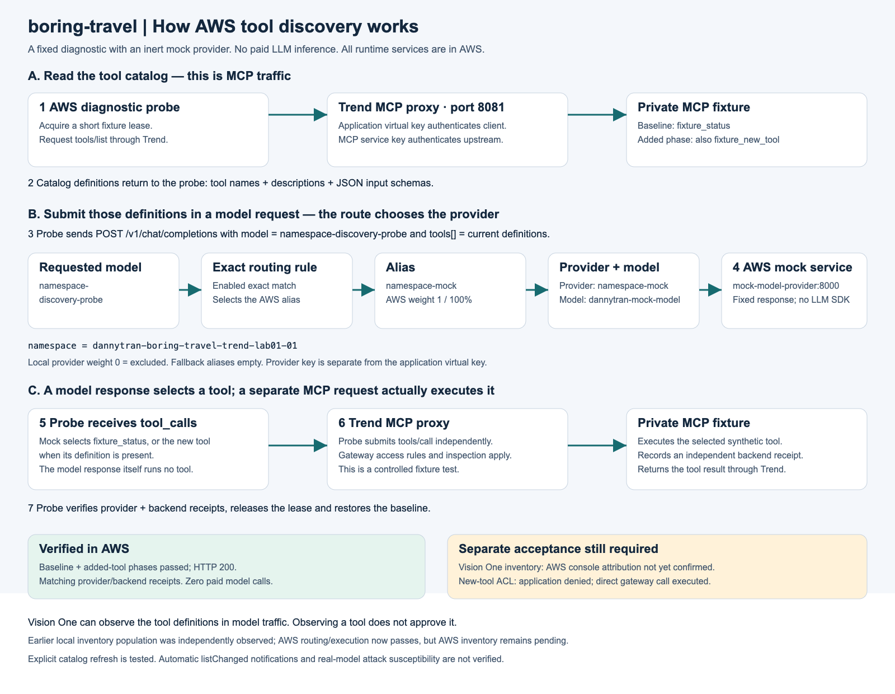
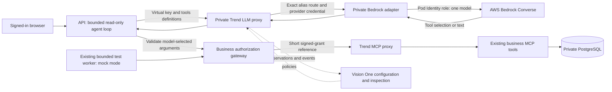
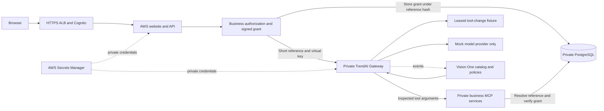
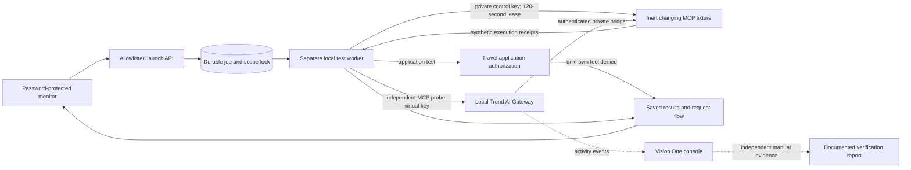
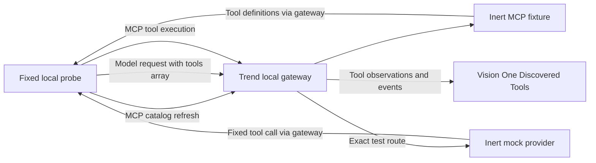

# the boring-travel company · AI security demo

A travel website with local and AWS deployment options, destination photography, a scripted travel assistant, protected MCP tools, and a separate password-locked operations dashboard. All travelers, hotels, bookings, payments and attack fixtures are synthetic. The build makes no paid model calls and does not deploy AWS resources automatically.

For development or agent continuation, read the [LLM interpretation guide](docs/LLM_GUIDE.md),
[AGENTS.md](AGENTS.md), and the
[agent handoff](docs/AGENT_HANDOFF.md). The [test and validation inventory](docs/test-validation-matrix.md)
lists completed checks, exact unit cases, evidence limits and pending AWS acceptance tests.

## Current AWS deployment status — October 23, 2026

**The hosted application is offline.** The user authorized AWS teardown after
local encrypted recovery capture. Load balancer, application DNS and Cognito have
been removed; both deployment stacks are deleted and the final scoped audit passed. See the [teardown record](docs/aws-teardown-status.md).

Historical pre-teardown results: all 11 deployments ready, HTTPS/Cognito working,
core AWS checks 12/12 and browser Inspection 3/3. The corrected mock discovery route
passed baseline and added-tool phases with provider/backend receipts and no paid
model calls. These results do not mean an AWS application is currently running.

**Full security acceptance remains incomplete:** direct gateway access executed a
new synthetic tool that the application correctly rejected. Independent AWS
Vision One inventory confirmation is also pending. Dynamic suite: 10 passed,
1 failed, 2 unavailable. The website assistant is scripted; the discovery model
provider is an inert fixture.

[Issues, fixes and remaining checks](docs/aws-deployment-issues.md) ·
[How discovery and model linking work](docs/aws-discovery-explained.md) ·
[Bedrock deployment option and runbook](docs/bedrock-deployment-option.md)

## Consolidated second-deployment fixes

The supplied second-deployment working directory is consolidated into this branch.
It adds the second naming prefix, fixes the Bedrock adapter manifest and shortened
ALB-name validation, and supports an optional builder-only CA. Public website access
is now explicit (`DEPLOYMENT_PUBLIC_WEB=true`) and separate from restricted EKS
administration. Default access remains restricted.

The export reports a benign live Nova Micro chat on a separate deployment; that
observation has not been independently rechecked here. It does not change the
verified teardown of our original deployment. See the
[comparison, integration decisions and validation](docs/deployment-consolidation.md).

### Discovery mechanism

The probe reads MCP tool definitions, submits them in a model request through
Trend, receives a fixed tool selection from the mock, then makes a separate MCP
execution request. Routing chooses the model provider; observation does not grant
tool permissions. The AWS runtime has no dependency on local application services.



[Editable SVG](docs/architecture/10-aws-discovery-mechanism.svg) ·
[Model-linking Mermaid](docs/architecture/10-aws-discovery-model-linking.mmd) ·
[Full sequence Mermaid](docs/architecture/11-aws-discovery-sequence.mmd)

## Optional AWS Bedrock chat

The real-model option is **implemented locally and offline-tested, not deployed**.
It adds a private OpenAI-shaped adapter behind Trend that invokes one selected
in-region Bedrock model using an EKS Pod Identity role. The API runs a bounded,
read-only tool loop; mock worker/fixture behavior and the working mock route remain
separate. Deployment defaults to disabled inference. Existing AWS mock results do
not establish real-model behavior or Bedrock acceptance.



`make bedrock-plan` performs an offline preview. The
[Bedrock runbook](docs/bedrock-deployment-option.md) covers rendering, change-set
review, preparation, generated one-time Vision One setup, explicit paid activation
and guarded rollback. [LLM guide](docs/LLM_GUIDE.md) explains how to read this repo.

## Architecture diagrams

These diagrams distinguish the original local app, the separate Trend integration,
and the AgentCore target design. The single-copy AWS Trend application is hosted
and its latest core acceptance run passed 12/12. Dynamic inventory acceptance
remains incomplete; the AgentCore fleet remains unverified end to end.

### AWS Trend gateway deployment

The website, backend, private MCP services, PostgreSQL and self-hosted Trend
Gateway run in AWS. Cognito protects public HTTPS access, followed by a separate
monitor password. The authenticated browser test launcher has been verified.

The business gateway authorizes and signs exact tool arguments. For the AWS Trend
path it stores that signed grant privately under a hash of a short, expiring random
reference. Trend inspects the business arguments and short reference; the backend
resolves it and verifies the original grant, expiry and argument scope. This avoids
the observed full-token false positive without disabling policy or signature checks.
Local and AgentCore modes retain their original capability transport.

The latest AWS synthetic suite passed **12/12**, including ordinary reads, six
application authorization denials, request and response inspection, and unchanged
bookings. An earlier run missed its request-block expectation; that evidence is
retained. These fixed probes do not establish real-model susceptibility or universal
protection. No paid model inference was used. After correcting the exact model match and excluding the local provider, mock
model discovery passed both baseline and added-tool phases with HTTP 200 and
matching provider/backend receipts. Independent Vision One inventory acceptance
is pending.
The latest dynamic-tool run passed 10 checks, failed direct gateway denial of the
new synthetic tool, and left notification/inventory checks unavailable. The
application allowlist rejected that tool; upstream access alone did not quarantine it.



[Deployment runbook](infra/trend-aws/README.md) ·
[Current evidence and resume notes](docs/AWS_TREND_RESUME.md) ·
[Dynamic-tool results](docs/trend-aws-dynamic-results.json) ·
[Historical guardrail comparison](docs/trend-capability-comparison.md) ·
[Vision One setup](docs/trend-aws-console-setup.md)

### Non-AgentCore local deployment

The app uses its reference enforcement gateway. The separately installed Trend AI Gateway is not on this application request path.


[Editable SVG](docs/architecture/01-non-agentcore-local.svg) · [Mermaid source](docs/architecture/01-non-agentcore-local.mmd)

### Local Trend MCP deployment — implemented, acceptance blocked

A separate test app on port **8082** routes tools through the local Trend MCP
gateway. All ten tools are discovered, and Trend blocks the synthetic injection
probe. **Legitimate signed app requests are also denied**, so normal-use acceptance
is incomplete. The original 8080 and offline AgentCore 8081 apps keep their routes.
No AWS resources or paid model inference were used for this local integration.


[Editable SVG](docs/architecture/05-trend-local-deployment.svg) · [Mermaid source](docs/architecture/05-trend-local-deployment.mmd)

### Trend inspection — observed test flows

The comparison separates backend authorization rejection, a real vendor content
policy denial, and the current compatibility blocker. A single blocked injection
is not evidence of general attack protection or a real model being persuaded.


[Editable SVG](docs/architecture/06-trend-inspection-test-flows.svg) · [Mermaid source](docs/architecture/06-trend-inspection-test-flows.mmd) · [Setup and detailed test results](docs/trend-local-test.md)

### AgentCore target design — planned

This is the intended full deployment, not a claim of deployed infrastructure. The new AWS fleet option supplies hosting, operator login, private tool ingress and gateway templates; live end-to-end verification remains pending.


[Editable SVG](docs/architecture/02-agentcore-target-design.svg) · [Mermaid source](docs/architecture/02-agentcore-target-design.mmd)

### AgentCore implementation and AWS test scope

The offline implementation and the historical AWS test are different environments. The AWS test used real AgentCore and Trend inspection with one read-only fixture; it did not host the full app or invoke a model. Trend allowed the tested injection, and all test-created AWS resources were subsequently removed.


[Editable SVG](docs/architecture/03-agentcore-implementation-and-test-scope.svg) · [Mermaid source](docs/architecture/03-agentcore-implementation-and-test-scope.mmd)

See the [diagram index](docs/architecture/README.md), [AgentCore implementation notes](docs/agentcore-alternative.md), and [recorded AWS test results](docs/aws-test-deployment.md).

### Dynamic MCP tool changes — implemented and tested locally

The private monitoring page now has an opt-in **Tool changes** suite. The fixture
is isolated from travel data and excluded from **All safe checks**. The diagrams
below describe the implemented test path and the observed 2026-10-22 outcome.



```mermaid
sequenceDiagram
    participant W as Test worker
    participant F as Synthetic MCP server
    participant G as Trend gateway
    participant A as Application
    participant V as Vision One
    W->>F: Acquire private lease; establish baseline
    W->>F: Advertise a new inert tool
    W->>G: tools/list in existing and fresh sessions
    G->>F: Refresh upstream catalog
    G-->>W: New tool advertised (observed)
    W->>A: Request unapproved tool
    A-->>W: UNKNOWN_TOOL; no downstream dispatch
    W->>G: Direct call to new tool
    G->>F: Call forwarded under current configuration
    F-->>W: Synthetic execution receipt
    G-->>V: Allow event (independently observed)
    Note over W,V: Discovery is not approval; direct-access expectation FAILED
    W->>F: Release lease; restore baseline
```

**Result:** the live Trend proxy exposed the added tool and contract changes;
application authorization rejected the new tool, but a direct gateway call
executed it. Vision One recorded that call as **Allow**. The console's
Discovered Tools page was empty in that direct-MCP test. The subsequent
[model-routing experiment](docs/model-discovery-probe.md) populated it with both
synthetic tools. Active MCP import still has a separate missing-secret blocker. This is an access-control acceptance failure,
not a successful vendor blocking test. Notifications are not tested by this
stateless fixture.

[Setup, cases and evidence](docs/tool-changes.md) ·
[Earlier direct-MCP inventory diagnosis](docs/trend-discovery-diagnosis.md) ·
[Architecture source](docs/architecture/07-dynamic-mcp-tool-tests.mmd) ·
[Observed-flow source](docs/architecture/08-dynamic-mcp-observed-flow.mmd)

## Monitoring test launcher

The protected monitoring page now launches allowlisted checks through a separate
worker, with saved progress, request flows, retry protection and a bounded runtime.
Choose **Connectivity**, **Authorization**, **Inspection**, **All safe checks**, or the opt-in **Tool changes** experiment.
Runs survive page refreshes and API restarts. Reference-mode inspection is marked
unavailable; offline AgentCore inspection is labeled simulation.

```sh
make runner-up           # localhost:8083/monitor, separate reference test project
make runner-offline-up   # localhost:8084/monitor, separate offline AgentCore project
# Sign in using your private MONITOR_PASSWORD, select a suite, click Run tests.
make runner-down
make runner-offline-down
```

See [launcher setup, limits and evidence](docs/test-launcher.md). The single-copy
AWS Trend deployment runs a durable queue and bounded one-shot Kubernetes worker;
human Cognito/monitor login and a browser-launched Inspection run were verified.
The separate AgentCore fleet's AWS launcher remains unverified. Older
[AWS session notes](docs/AWS_SESSION_HANDOFF.md) describe the earlier local-only
stage; use [the current Trend handoff](docs/AWS_TREND_RESUME.md) for continuation.
Historical local previews are documented in their dated reports and are not
required by the running AWS application. No paid model inference was enabled.

## Multiple isolated AWS deployments

The [AWS fleet option](docs/aws-multi-deployment.md) creates complete, separate copies driven by `DEPLOYMENT_COUNT` in `.env`, named `dannytran-travel-lab01-01`, `-02`, and so on. Each copy has its own VPC, private Fargate application, RDS database, Cognito operator login, HTTPS URLs, monitoring password, AgentCore gateways and inspector. Only the inspectors share the existing Trend AI Guard detection secret. Reducing the count never deletes copies; teardown selects one exact copy and preserves the shared key.


[Editable SVG](docs/architecture/04-aws-multi-deployment.svg) · [Mermaid source](docs/architecture/04-aws-multi-deployment.mmd) · [Configuration, deployment and teardown](docs/aws-multi-deployment.md)

```sh
# Offline preview; no AWS credentials or calls required.
uv run --frozen --extra aws-deploy python -m scripts.aws_fleet plan --env-file .env
```

This deployment code is locally validated and has **not been deployed to AWS**. All AWS writes require explicit apply/cost flags and matching account configuration. Paid inference defaults to disabled. Each copy has recurring hosting costs; teardown snapshots the database and retains application secrets/logs for explicit cleanup. The default cloud chatbot is scripted and uses real AgentCore tool routing. Live model behavior and effective Trend attack blocking remain unverified.

## Run locally

Requires Docker Desktop with Compose, Make, and Python 3 for host-side verification scripts.

1. Copy `.env.example` to `.env` and set `MONITOR_PASSWORD` to a unique 24–256 character password. Keep `.env` private (`chmod 600 .env`).
2. Run `make up` for the current implementation.
3. Optionally run `make agentcore-up` for the separate offline AgentCore implementation.

| | Current implementation | Offline AgentCore alternative |
| --- | --- | --- |
| Travel website | http://localhost:8080 | http://localhost:8081 |
| Private monitoring | http://localhost:8080/monitor | http://localhost:8081/monitor |

Choose Alice or Bob to browse 12 stays across Lisbon, Kyoto and Vancouver. Open **A little travel help** to search stays, request hotel details or view that traveler’s trips. Traveler changes clear the conversation. The assistant is deterministic and each message is standalone; it is not a live LLM. Booking mutations, payments and approval grants are not available through this chat.

The monitoring page uses `MONITOR_PASSWORD`, independently of traveler/admin demo identities. It shows saved attack outcomes, actual application events, audit records and request traces. Historical audits without step telemetry are labeled accordingly. Passwords, raw chat messages and credentials are excluded from logs. See [monitoring setup and evidence scope](docs/monitoring.md).

## Verify

```sh
make lint smoke chat-test monitor-test scenarios
make agentcore-chat-test agentcore-monitor-test
```

`make test` and `make agentcore-test` also run the broader synthetic booking lifecycle tests, which create and cancel test reservations. The focused chat and monitoring checks preserve existing bookings. The latest complete unit suite passes **287 cases**. Earlier local checks verified protected monitoring, all six reference-policy attack fixtures, chat regressions and offline AgentCore contracts. The separate Trend app currently fails normal-use smoke and full integration under active inspection; see [its exact results](docs/trend-local-test.md) and the [test inventory](docs/test-validation-matrix.md). See [monitoring verification](docs/monitoring-verification.json) and [attack vector map](docs/attack-vectors.md).

`make down` and `make agentcore-down` stop their respective stacks while preserving data. `make seed` is idempotent. `make demo-reset` deletes the current stack’s synthetic database contents and reseeds them.

## Enforcement and evidence

The original local path is browser → NGINX → Next.js / FastAPI → local reference policy → three MCP services → Postgres. The alternative keeps the company UI but routes inference/tool requests through local AgentCore contract simulators with interceptor tests. Each stack has its own database, networks and session cookies. Only NGINX exposes a loopback port.

Ownership, workload permissions, scoped capabilities and explicit mutation approvals are enforced server-side. The six attack fixtures exercise indirect injection, cross-customer reads, privileged-tool misuse, approval requirements, bulk-data transfer and identity spoofing. The injection fixture forces a malicious tool request; it does not show a real model being persuaded. Unprotected consequences are hypothetical.

Synthetic persona selection and shared service credentials are not production customer identity mapping. The separate historical AgentCore staging test verified routing/inspection but allowed its injection; those historical test resources were removed, as recorded in [that report](docs/aws-test-deployment.md). The current single-copy Trend AWS application remains running and has distinct passing request/response probes, unresolved new-tool gateway denial and pending inventory attribution; see [current status](docs/aws-deployment-issues.md). Local policy denials and offline interceptor results must not be described as live Trend detections. See [assistant behavior](docs/travel-assistant.md), [architecture](docs/adr-001.md), and [AgentCore handoff](docs/agentcore-alternative.md).

## Generic AWS deployment preparation

AWS clients, Lambda interceptor packaging, CloudFormation foundation and gateway request templates are included. A separate [isolated AWS gateway test deployment](docs/aws-test-deployment.md) adds explicit account checks, private artifacts, a dedicated secret, live inspection, a synthetic read-only tool and bounded verification commands; it does not host the full application. The test environment has been torn down; its deployment and guarded cleanup commands remain available. The historical staging implementation passed 130 offline unit tests; the current complete suite passes 287. `make agentcore-plan` validates request shapes offline; `make agentcore-package` builds a local Lambda ZIP.

`make monitor-secret-plan` previews Secrets Manager setup without contacting AWS. To create the monitoring secret, a deployer authenticates separately using their normal AWS workflow and explicitly runs `scripts/deploy_monitor_secret.py --apply` with the project’s Python dependencies installed. The script uses the SDK credential chain; it embeds no account, login flow or access key. It reads the password from private `.env`, creates a new secret, records its ARN, and emits runtime configuration plus a narrowly scoped read policy. See the [AWS secret deployment instructions](docs/monitoring.md#generic-aws-secret-deployment).

Explicit AWS and paid-inference opt-ins remain required. Local containers do not mount AWS credentials and their private service network has no internet egress. Publishing this repository does not deploy services or enable model billing.

## Local Trend gateway option

The default app keeps its reference route. A separate local `trend-gateway` profile on port 8082 now routes through the installed Trend MCP proxy, using an application virtual key and exact discovered tool mappings. All ten tools are discovered. **Inspection currently rejects legitimate signed requests**, so this option is not acceptance-tested for normal use. See [local Trend test setup and results](docs/trend-local-test.md). The public chart and local templates are under `infra/trend-gateway/`. Supplied guides, tenant registration overrides, API keys, local cluster credentials and generated runtime files are excluded from Git. See [gateway integration notes](infra/trend-gateway/README.md).

Photography sources and license links are in [the image credits](docs/photography.md) and `frontend/public/photos/credits.json`.

## Verified local model-tool discovery

Vision One now lists both the baseline and newly introduced synthetic tool after
their definitions pass through the local Trend LLM proxy to an inert mock provider.
Both tool calls executed through Trend MCP and produced matching receipts. No AWS
deployment or paid model was needed. This is observed-tool inventory, not automatic
permission approval or proof of attack blocking.



[Setup, evidence, limits and current runtime state](docs/model-discovery-probe.md) ·
[Sanitized verification](docs/model-discovery-verification.json) ·
[Editable architecture source](docs/architecture/09-model-tool-discovery.mmd).

## Recovery before teardown

See the [recovery bundle guide](docs/recovery-bundle.md) for capture, verification, restore
steps and retention costs (about $4.50/month after teardown). The encrypted RDS
snapshot is available; local encrypted archive capture and offline verification succeeded (316 files, 9,116,370 bytes); S3 export was declined.
No teardown is authorized or performed by recovery capture. Inspect the private
latest-recovery receipt for actual completion; archive integrity is not a restore drill.
