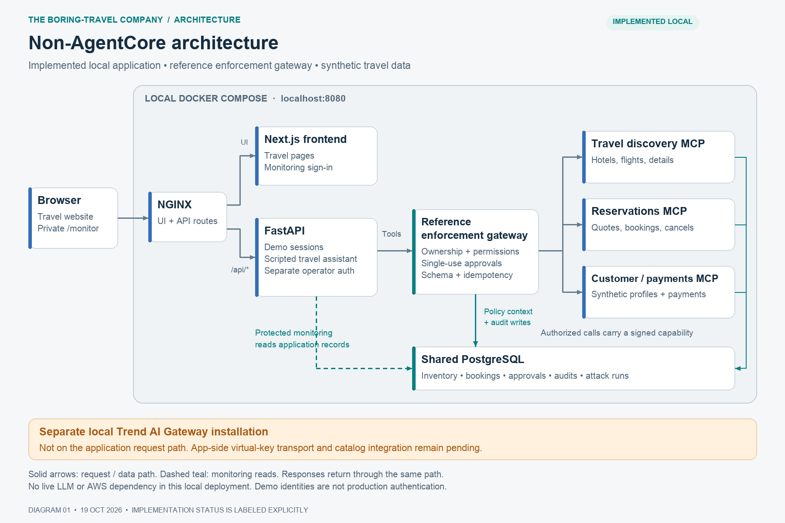
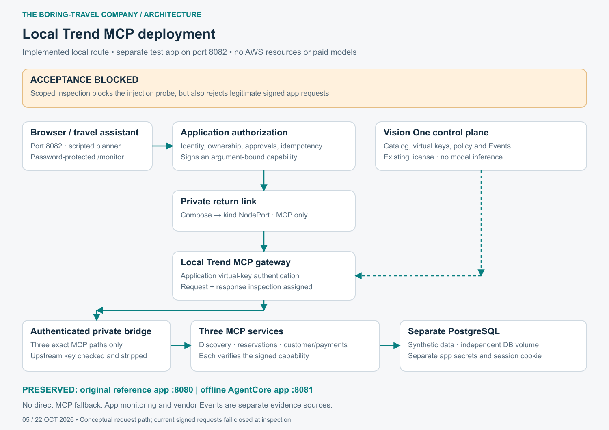
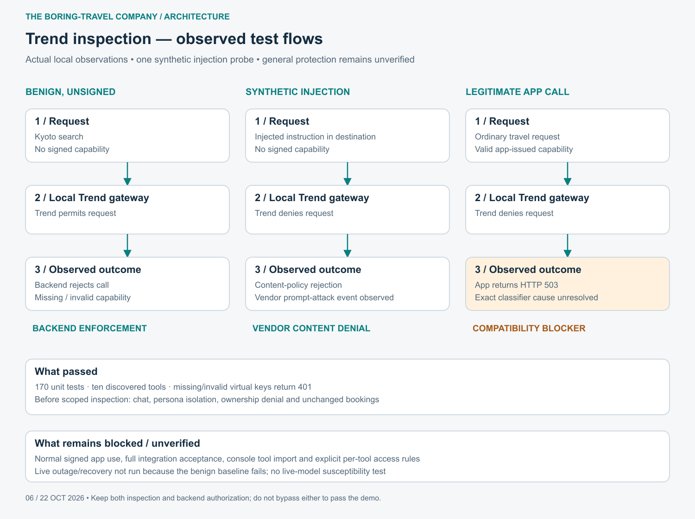
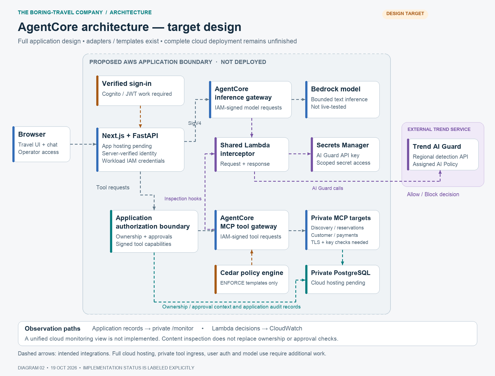
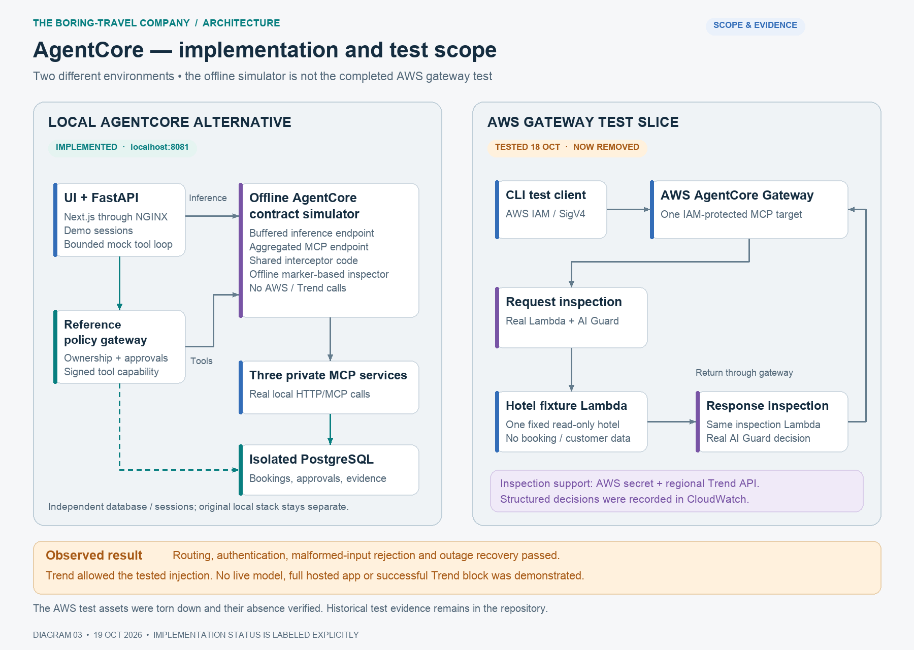
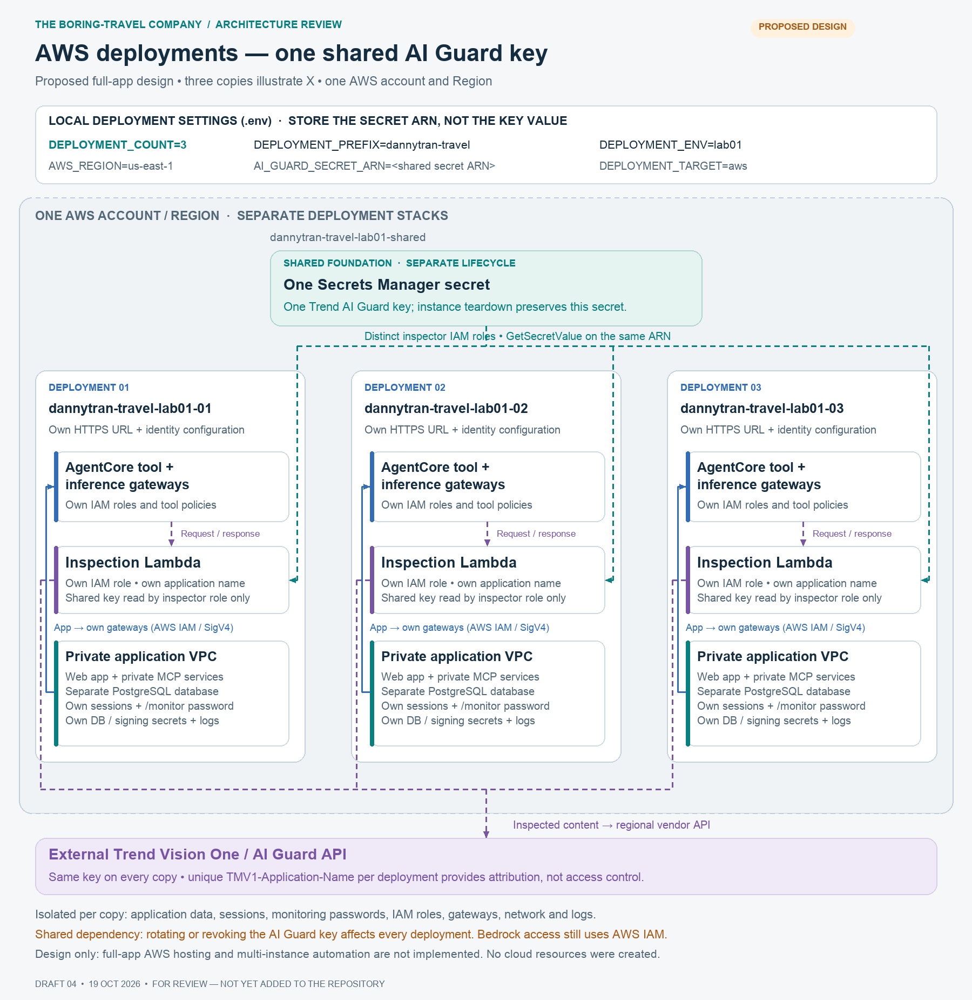

# the boring-travel company · AI security demo

A local travel website with destination photography, a scripted travel assistant, protected MCP tools, and a separate password-locked operations dashboard. All travelers, hotels, bookings, payments and attack fixtures are synthetic. The build makes no paid model calls and does not deploy AWS resources automatically.

For development or agent continuation, start with [AGENTS.md](AGENTS.md) and the
[agent handoff](docs/AGENT_HANDOFF.md). The [test and validation inventory](docs/test-validation-matrix.md)
lists completed checks, exact unit cases, evidence limits and pending AWS acceptance tests.

## Architecture diagrams

These diagrams distinguish the original local app, the separate local Trend integration, the full AgentCore target design, and the historical AWS test that was torn down. The full AWS application remains unverified. Local Trend inspection blocks the tested injection but also rejects legitimate signed requests; that compatibility issue remains unresolved.

### Non-AgentCore local deployment

The app uses its reference enforcement gateway. The separately installed Trend AI Gateway is not on this application request path.



[Editable SVG](docs/architecture/01-non-agentcore-local.svg) · [Mermaid source](docs/architecture/01-non-agentcore-local.mmd)

### Local Trend MCP deployment — implemented, acceptance blocked

A separate test app on port **8082** routes tools through the local Trend MCP
gateway. All ten tools are discovered, and Trend blocks the synthetic injection
probe. **Legitimate signed app requests are also denied**, so normal-use acceptance
is incomplete. The original 8080 and offline AgentCore 8081 apps keep their routes.
No AWS resources or paid model inference were used for this local integration.



[Editable SVG](docs/architecture/05-trend-local-deployment.svg) · [Mermaid source](docs/architecture/05-trend-local-deployment.mmd)

### Trend inspection — observed test flows

The comparison separates backend authorization rejection, a real vendor content
policy denial, and the current compatibility blocker. A single blocked injection
is not evidence of general attack protection or a real model being persuaded.



[Editable SVG](docs/architecture/06-trend-inspection-test-flows.svg) · [Mermaid source](docs/architecture/06-trend-inspection-test-flows.mmd) · [Setup and detailed test results](docs/trend-local-test.md)

### AgentCore target design — planned

This is the intended full deployment, not a claim of deployed infrastructure. The new AWS fleet option supplies hosting, operator login, private tool ingress and gateway templates; live end-to-end verification remains pending.



[Editable SVG](docs/architecture/02-agentcore-target-design.svg) · [Mermaid source](docs/architecture/02-agentcore-target-design.mmd)

### AgentCore implementation and AWS test scope

The offline implementation and the historical AWS test are different environments. The AWS test used real AgentCore and Trend inspection with one read-only fixture; it did not host the full app or invoke a model. Trend allowed the tested injection, and all test-created AWS resources were subsequently removed.



[Editable SVG](docs/architecture/03-agentcore-implementation-and-test-scope.svg) · [Mermaid source](docs/architecture/03-agentcore-implementation-and-test-scope.mmd)

See the [diagram index](docs/architecture/README.md), [AgentCore implementation notes](docs/agentcore-alternative.md), and [recorded AWS test results](docs/aws-test-deployment.md).

## Monitoring test launcher

The protected monitoring page now launches allowlisted checks through a separate
worker, with saved progress, request flows, retry protection and a bounded runtime.
Choose **Connectivity**, **Authorization**, **Inspection** or **All safe checks**.
Runs survive page refreshes and API restarts. Reference-mode inspection is marked
unavailable; offline AgentCore inspection is labeled simulation.

```sh
make runner-up           # localhost:8083/monitor, separate reference test project
make runner-offline-up   # localhost:8084/monitor, separate offline AgentCore project
# Sign in using your private MONITOR_PASSWORD, select a suite, click Run tests.
make runner-down
make runner-offline-down
```

See [launcher setup, limits and evidence](docs/test-launcher.md),
[verification results](docs/test-launcher-verification.json), and the
[AWS session handoff](docs/AWS_SESSION_HANDOFF.md). **AWS test execution remains
explicitly disabled** until cloud authorization and dispatch are implemented.
All local stacks were shut down after validation; the dedicated local Trend cluster
is stopped. Database volumes and private configuration were preserved. No AWS
resources, DNS records or paid models were created/used for this work.

## Multiple isolated AWS deployments

The [AWS fleet option](docs/aws-multi-deployment.md) creates complete, separate copies driven by `DEPLOYMENT_COUNT` in `.env`, named `dannytran-travel-lab01-01`, `-02`, and so on. Each copy has its own VPC, private Fargate application, RDS database, Cognito operator login, HTTPS URLs, monitoring password, AgentCore gateways and inspector. Only the inspectors share the existing Trend AI Guard detection secret. Reducing the count never deletes copies; teardown selects one exact copy and preserves the shared key.



[Editable SVG](docs/architecture/04-aws-multi-deployment.svg) · [Mermaid source](docs/architecture/04-aws-multi-deployment.mmd) · [Configuration, deployment and teardown](docs/aws-multi-deployment.md)

```sh
# Offline preview; no AWS credentials or calls required.
uv run --frozen --extra aws-deploy python -m scripts.aws_fleet plan --env-file .env
```

This deployment code is locally validated and has **not been deployed to AWS**. All AWS writes require explicit apply/cost flags and matching account configuration. Paid inference defaults to disabled. Each copy has recurring hosting costs; teardown snapshots the database and retains application secrets/logs for explicit cleanup. The default cloud chatbot is scripted and uses real AgentCore tool routing. Live model behavior and effective Trend attack blocking remain unverified.

## Run locally

Requires Docker Desktop with Compose, Make, and Python 3 for host-side verification scripts.

1. Copy `.env.example` to `.env` and set `MONITOR_PASSWORD` to a unique 24–256 character password. Keep `.env` private (`chmod 600 .env`).
2. Run `make up` for the current implementation.
3. Optionally run `make agentcore-up` for the separate offline AgentCore implementation.

| | Current implementation | Offline AgentCore alternative |
| --- | --- | --- |
| Travel website | http://localhost:8080 | http://localhost:8081 |
| Private monitoring | http://localhost:8080/monitor | http://localhost:8081/monitor |

Choose Alice or Bob to browse 12 stays across Lisbon, Kyoto and Vancouver. Open **A little travel help** to search stays, request hotel details or view that traveler’s trips. Traveler changes clear the conversation. The assistant is deterministic and each message is standalone; it is not a live LLM. Booking mutations, payments and approval grants are not available through this chat.

The monitoring page uses `MONITOR_PASSWORD`, independently of traveler/admin demo identities. It shows saved attack outcomes, actual application events, audit records and request traces. Historical audits without step telemetry are labeled accordingly. Passwords, raw chat messages and credentials are excluded from logs. See [monitoring setup and evidence scope](docs/monitoring.md).

## Verify

```sh
make lint smoke chat-test monitor-test scenarios
make agentcore-chat-test agentcore-monitor-test
```

`make test` and `make agentcore-test` also run the broader synthetic booking lifecycle tests, which create and cancel test reservations. The focused chat and monitoring checks preserve existing bookings. The latest complete unit suite passes **197 cases**, including 14 Trend transport cases and 27 test-launcher cases. Earlier local checks verified protected monitoring, all six reference-policy attack fixtures, chat regressions and offline AgentCore contracts. The separate Trend app currently fails normal-use smoke and full integration under active inspection; see [its exact results](docs/trend-local-test.md) and the [test inventory](docs/test-validation-matrix.md). See [monitoring verification](docs/monitoring-verification.json) and [attack vector map](docs/attack-vectors.md).

`make down` and `make agentcore-down` stop their respective stacks while preserving data. `make seed` is idempotent. `make demo-reset` deletes the current stack’s synthetic database contents and reseeds them.

## Enforcement and evidence

The current path is browser → NGINX → Next.js / FastAPI → local reference policy → three MCP services → Postgres. The alternative keeps the company UI but routes inference/tool requests through local AgentCore contract simulators with interceptor tests. Each stack has its own database, networks and session cookies. Only NGINX exposes a loopback port.

Ownership, workload permissions, scoped capabilities and explicit mutation approvals are enforced server-side. The six attack fixtures exercise indirect injection, cross-customer reads, privileged-tool misuse, approval requirements, bulk-data transfer and identity spoofing. The injection fixture forces a malicious tool request; it does not show a real model being persuaded. Unprotected consequences are hypothetical.

This is a local demo. Identity selection and shared database/service credentials are not production authentication. The completed isolated AWS staging test verified gateway routing and live Trend inspection, but Trend allowed the tested injection. All test-created AWS resources were subsequently removed and their absence verified. Full application AWS/model integration and effective Trend blocking remain unverified; see [live AWS test results](docs/aws-test-deployment.md). Local policy denials and offline interceptor results must not be described as live Trend detections. See [assistant behavior](docs/travel-assistant.md), [architecture](docs/adr-001.md), and [AgentCore handoff](docs/agentcore-alternative.md).

## Generic AWS deployment preparation

AWS clients, Lambda interceptor packaging, CloudFormation foundation and gateway request templates are included. A separate [isolated AWS gateway test deployment](docs/aws-test-deployment.md) adds explicit account checks, private artifacts, a dedicated secret, live inspection, a synthetic read-only tool and bounded verification commands; it does not host the full application. The test environment has been torn down; its deployment and guarded cleanup commands remain available. The historical staging implementation passed 130 offline unit tests; the current complete suite passes 197. `make agentcore-plan` validates request shapes offline; `make agentcore-package` builds a local Lambda ZIP.

`make monitor-secret-plan` previews Secrets Manager setup without contacting AWS. To create the monitoring secret, a deployer authenticates separately using their normal AWS workflow and explicitly runs `scripts/deploy_monitor_secret.py --apply` with the project’s Python dependencies installed. The script uses the SDK credential chain; it embeds no account, login flow or access key. It reads the password from private `.env`, creates a new secret, records its ARN, and emits runtime configuration plus a narrowly scoped read policy. See the [AWS secret deployment instructions](docs/monitoring.md#generic-aws-secret-deployment).

Explicit AWS and paid-inference opt-ins remain required. Local containers do not mount AWS credentials and their private service network has no internet egress. Publishing this repository does not deploy services or enable model billing.

## Local Trend gateway option

The default app keeps its reference route. A separate local `trend-gateway` profile on port 8082 now routes through the installed Trend MCP proxy, using an application virtual key and exact discovered tool mappings. All ten tools are discovered. **Inspection currently rejects legitimate signed requests**, so this option is not acceptance-tested for normal use. See [local Trend test setup and results](docs/trend-local-test.md). The public chart and local templates are under `infra/trend-gateway/`. Supplied guides, tenant registration overrides, API keys, local cluster credentials and generated runtime files are excluded from Git. See [gateway integration notes](infra/trend-gateway/README.md).

Photography sources and license links are in [the image credits](docs/photography.md) and `frontend/public/photos/credits.json`.
