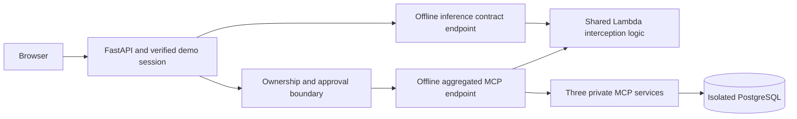

# AgentCore alternative — local implementation and AWS handoff

The current boring-travel site remains at http://localhost:8080 with its original default transport. The new option is a separate Compose project at http://localhost:8081 with its own network, sessions, inventory, bookings, approvals and audit database. The existing Trend Kubernetes deployment remains separate and unchanged.

## Start, test and stop

From the repository root:

```sh
make agentcore-up
make agentcore-test
make agentcore-plan
make agentcore-package
make agentcore-down
```

`make agentcore-up` starts **boring-travel-agentcore**, using `compose.yaml` plus `compose.agentcore.yaml`. Do not apply the overlay with the original project's name. The original `make up/down/test` continue to target only the original project. The customer website and brand are identical; deployment selection is an operator setting, not a customer-facing security switch.

All runtime services are on an internal Docker network. Only the alternate NGINX publishes loopback port 8081. No AWS or Trend credentials are mounted into the offline stack. Initial image/package downloads need internet; runtime tests need no AWS account and make no model or live Trend API calls.

## What the offline option actually does



The simulator exposes Anthropic-style buffered Messages at `/inference/v1/messages` and namespaced MCP tools at `/tools/mcp`. The actual Python MCP SDK handles HTTP discovery/invocation. Canonical tool names are mapped to `target___tool`; schemas shown to the agent hide internal gateway capabilities. Model tools still pass through the existing ownership/approval gateway before reaching the aggregated endpoint. The model cannot mint approvals or change verified identity.

`OfflineInspector` is only a deterministic test fixture: text containing `AIGUARD_TEST_BLOCK` is blocked, and `AIGUARD_TEST_UNAVAILABLE` simulates a service outage. This is neither AWS AgentCore nor real Trend detection. The fixture does not classify arbitrary prompt injections. Existing six attack fixtures continue to exercise the reference authorization policy, not Cedar or Trend. The extra inspection tests prove contract behavior, not detection accuracy.

## Lambda interceptor

`services/agentcore/interceptor.py` supports the two AWS envelope types:

- HTTP/inference: strict base64 JSON bodies, request and response inspection, null request on response, system/history/tool-use arguments/tool-result text included.
- MCP: parsed JSON `tools/call` arguments and tool results inspected. Known protocol metadata operations pass without content inspection. Signed backend capabilities and HTTP authorization headers are excluded from inspection payloads.
- Buffered text only. Streaming, images, malformed bodies, oversized payloads and unsupported structures are rejected. Input `max_tokens` is capped at 512; the adapter sends 400.
- A block returns a transformed gateway response. Unknown decisions, credential/configuration errors, inspection timeouts and unexpected exceptions fail closed. No fallback to direct models/tools exists.
- Audit logs contain stage, contract, action, reason code/count and a bounded invocation ID. They contain no raw prompts, outputs, API keys or vendor reason strings. An output block does not reverse a tool mutation; ownership and approval checks must succeed before dispatch.

`inspection.py` includes a live AI Guard HTTP client with a fixed regional HTTPS allowlist, disabled redirects/environment proxies, one-secret lookup, five-minute cache and one refresh-on-401. Only explicit Allow/Block decisions are accepted. This client has been tested with fakes; the saved Vision One credentials have NOT been tried against the real detection API in this phase. Its action schema and assigned AI Policy must be validated in staging before deployment.

## AWS-ready pieces and explicit limits

`services/agentcore/transport.py` includes AWS IAM SigV4 MCP/inference transport with strict AWS endpoint validation. AWS calls require `DEPLOYMENT_PROFILE=agentcore-aws` and `ENABLE_AWS_AGENTCORE=true`. Paid inference additionally requires `MODEL_MODE=agentcore` and `ENABLE_PAID_INFERENCE=true`. The default profile and all supplied local commands leave these disabled. These activation flags are operational guards, not authorization to incur charges; obtain user approval first.

`infra/agentcore/interceptor.template.json` is a CloudFormation **foundation**, not a complete cloud app. It defines Lambda, short-retention logs, restricted concurrency, one-secret IAM access, optional scoped KMS decryption, and a Gateway role that can invoke only the inspector. It references an existing secret ARN and approved S3 ZIP; no credential values are embedded. Model invocation, target credential access and gateway-caller policies must be scoped and attached after approval; they are deliberately not broadly granted here.

`make agentcore-plan` renders control-plane request payloads and validates them against the installed botocore service model without creating an AWS client. It includes two IAM-authenticated gateways, the Bedrock Mantle connector, three private HTTPS MCP targets with API-key providers, and an ENFORCE policy engine. Cedar examples permit only discovery and owned-read tool types. Cloud mutations/refunds/bulk reads remain default-denied until the workload-specific authorization policies are reviewed. SDK shape validation is not AWS service-side Cedar/schema or Region validation.

The example config contains placeholders. Gateway and policy-engine IDs/ARNs must be filled from the corresponding approved creation steps before later payloads can be submitted. The planner does not execute operations. Cedar policies are scoped to the exact gateway ARN. No broad principal permission here replaces the backend ownership/capability checks.

Before a cloud rollout we still need: approved account/Region/model/budget; hosted private TLS MCP endpoints and database; ingress verification for `X-MCP-Service-Key` (not implemented by the current local FastMCP servers); API-key providers; rotated signing keys; a verified user identity solution for any internet-accessible app; scoped IAM/model permissions; network access to AWS and regional Trend APIs; service-side policy validation and end-to-end staging evidence. The offline Compose network cannot reach AWS and is not a cloud deployment overlay.

AgentCore Runtime migration, full ECS/VPC/RDS provisioning, production Cognito login, and live cloud policy evaluation are not implemented in this first phase. No AWS resources, secret uploads, Trend detection calls or paid inference were performed.

## Packaging and cost review

`make agentcore-package` creates `build/agentcore-interceptor.zip` locally with only the handler and inspection modules. No credentials, developer files or vendor documents are included. `build/` is Git-ignored.

Before any deployment, review charges for AgentCore requests/Policy, Lambda, Secrets Manager, CloudWatch, S3, private networking/VPC Lattice, hosted MCP/database resources and Bedrock inference. Response blocking occurs after inference and cannot eliminate its cost. Set service quotas, token limits, logging retention and cleanup steps; budget alerts are not a spending cap.

## Technical references

- Supplied guide: `AI_Gateway/TrendAI-AIGuard-AgentCore-Guide/aiguard-agentcore.html` (reference material; its provisioning commands were not executed).
- https://docs.aws.amazon.com/bedrock-agentcore/latest/devguide/gateway-interceptors-types.html
- https://docs.aws.amazon.com/bedrock-agentcore/latest/devguide/gateway-target-inference-connector.html
- https://docs.aws.amazon.com/bedrock-agentcore/latest/devguide/policy-getting-started.html
- https://docs.aws.amazon.com/bedrock-agentcore/latest/devguide/gateway-vpc-egress.html

## Verification on 2026-10-17

- Final `make agentcore-up`: nine alternative containers healthy; the original stack was not recreated.
- `make agentcore-test`: **61 unit tests passed**, existing actual HTTP/MCP/PostgreSQL integration passed, and AgentCore-specific contract smoke checks passed. All six reference authorization fixtures passed without denied mutations.
- Alternative Ruff lint/format checks passed. CloudFormation `cfn-lint` passed. `make agentcore-plan` validated all request shapes using botocore without creating clients.
- `make agentcore-package`: local ZIP opened and checked; only the handler/inspection package modules are present.
- `scripts/agentcore_outage.py`: physically stopped only the alternate simulator, attempted an approved booking and a chat request, received 503 for both, restored the simulator in finally, and verified no bookings changed. Original site stayed healthy.
- Published proxy/session/owned-booking smoke checks passed on both 8080 and 8081. Browser hotel search on the alternative returned the catalogue and Alice's own bookings.
- One existing FastAPI/Starlette TestClient dependency deprecation warning remains; tests passed.

Machine-readable evidence: `docs/agentcore-verification.json`.

Optional outage test from an environment with this project's Python dependencies and the Docker CLI (requires `uv`):

```sh
uv run --frozen python scripts/agentcore_outage.py
```

That test temporarily interrupts only the alternative gateway and always attempts restoration. No original-stack reset was performed. Test-created quotes/audits and cancelled test bookings remain isolated in the alternative database.
