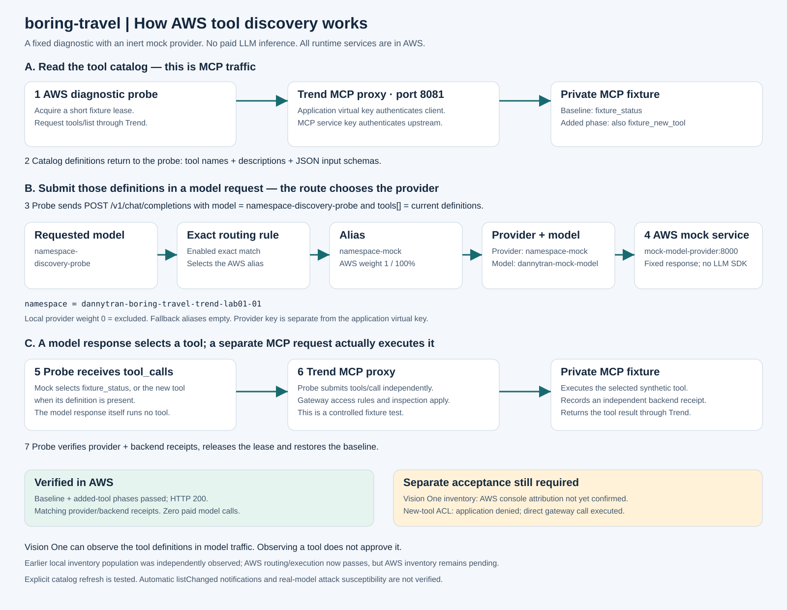
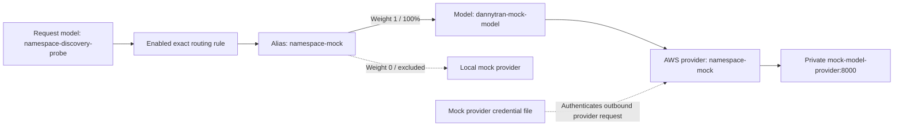

# How AWS tool discovery works

The diagnostic first asks an MCP server what tools exist, then includes those
**tool definitions in a model request through Trend**. The model route picks where
that model request goes. The returned tool selection is executed in a separate MCP
call. An inventory entry, a model selection and permission to execute are three
different things.

This is the implemented bounded AWS diagnostic, not a general model-powered
production chatbot. The website assistant remains scripted. The diagnostic uses
an inert OpenAI-shaped mock server: no Bedrock call, external LLM or paid inference.



[PNG preview](architecture/10-aws-discovery-mechanism.png) ·
[Editable SVG](architecture/10-aws-discovery-mechanism.svg) ·
[Configuration Mermaid](architecture/10-aws-discovery-model-linking.mmd) ·
[Sequence Mermaid](architecture/11-aws-discovery-sequence.mmd)

## Why there are two paths

**MCP path:** `tools/list` obtains names, descriptions and input schemas from the
MCP server. `tools/call` invokes one of those tools. Trend's private MCP listener
handles this traffic on port 8081. Refreshing the catalog lets the probe see a tool
that the server added after the earlier list.

**Model path:** the probe copies those definitions into the `tools[]` array of an
OpenAI-shaped `POST /v1/chat/completions` request. Trend's private LLM listener on
port 8080 routes this request to the mock provider. The mock returns a `tool_calls`
selection, but that response does not run the tool. The probe makes the separate
MCP call afterward. The two listeners belong to the same deployed Trend gateway;
the model route does not configure MCP upstream URLs.

During earlier local testing, direct MCP traffic produced Events while the
Discovered Tools inventory stayed empty. Submitting definitions in model requests
then populated that local inventory. This is the observed working path for this
preview version; it does not prove every vendor inventory path requires a model
request. The same AWS routing and execution flow now passes, but AWS inventory
still needs independent console confirmation.

## What each model configuration entry means

For this deployment, `namespace` below means
`dannytran-boring-travel-trend-lab01-01`.

| Entry | Exact value | Purpose |
|---|---|---|
| Requested model | `dannytran-boring-travel-trend-lab01-01-discovery-probe` | Client-side routing label sent in the model request |
| Routing rule | `dannytran-boring-travel-mockroute` | Enabled exact match from that label to the alias |
| Alias | `dannytran-boring-travel-trend-lab01-01-mock` | Groups candidate provider/model entries; it is not a credential or an MCP server |
| AWS provider | `dannytran-boring-travel-trend-lab01-01-mock` | Registered connection to the private mock service |
| Provider model | `dannytran-mock-model` | Actual model identifier accepted by the mock service |
| Provider URL | `http://mock-model-provider:8000` | Private AWS service; provider API adds `/v1/chat/completions` |
| AWS target weight | `1` (100% of this rule) | Routes all matching diagnostic requests to the AWS mock |
| Local target weight | `0` (excluded) | Prevents the AWS rule from sending traffic to the local mock |
| Fallback aliases | Empty | Keeps the test on its intended mock route |

The provider and alias happen to share a name. They are separate objects.
The requested-model label also differs from the actual provider model name.



Trend's documented configuration model is provider -> model -> alias, with routing
rules targeting aliases. The rule's per-model weights choose among members of
that alias. [Official resource guide](https://docs.trendmicro.com/en-us/documentation/article/trend-vision-one-AIG-resources),
[official routing guide](https://docs.trendmicro.com/en-us/documentation/article/trend-vision-one-AIG-controls).

## End-to-end sequence

```mermaid
sequenceDiagram
    participant P as AWS fixed diagnostic probe
    participant G as Trend Gateway (MCP + LLM proxies)
    participant F as Private MCP fixture
    participant M as Private mock model provider
    participant V as Vision One inventory
    Note over P,F: Repeat for baseline, then newly added tool
    P->>F: Acquire lease / select fixed fixture state (private control)
    P->>G: 1. MCP tools/list with application virtual key
    G->>F: Authenticated catalog request
    F-->>G: Tool names, descriptions and JSON schemas
    G-->>P: 2. Current MCP definitions
    P->>G: 3. POST /v1/chat/completions with model + tools[]
    Note over G,M: Exact route -> alias -> weighted model/provider
    G->>M: 4. Request to AWS mock using provider credential
    G-->>V: Observations/activity (AWS inventory confirmation pending)
    M-->>G: 5. Fixed tool_calls response; no real inference
    G-->>P: Selected tool name and arguments
    P->>G: 6. MCP tools/call for the selected fixture tool
    G->>F: Execute authenticated synthetic tool
    F-->>G: Tool result and independent execution receipt
    G-->>P: Tool result
    P->>M: 7. Check authenticated provider receipt
    P->>F: Check backend receipt / release lease / restore baseline
    Note over P,V: Discovery, permission, execution and console inventory are separate checks
```

The probe runs two phases. Baseline supplies `fixture_status`; added supplies both
`fixture_status` and `fixture_new_tool`. The mock deliberately chooses the newly
added tool when it is present. This fixed selection tests wiring and observation,
not LLM reasoning, autonomous discovery or prompt-injection susceptibility.
Provider receipts verify the definitions arrived; backend receipts verify execution.
The private fixture lease is released in `finally`, restoring the baseline.

## Which key is used where

| Credential | Used by | Purpose |
|---|---|---|
| Gateway enrollment token | Gateway installation | Register with Vision One; not an application request key |
| Application virtual key | Probe/application -> Trend | Authenticate requests and select the service identity |
| MCP service key | Trend -> private MCP upstream | Authenticate the upstream connection |
| Mock provider key | Trend -> mock provider | Authenticate model requests; also protects receipt reads |
| Fixture control key | Probe -> private fixture control | Bound changes, receipt observation and restoration |
| Signed business capability/reference | Normal application -> business MCP tools | Enforce ownership, exact arguments, expiry and approvals |

These values are private and are not interchangeable. AWS runtime secrets live in
Secrets Manager and private Kubernetes mounts. The separate AgentCore option uses
an AI Guard detection credential; it is not used by this mock discovery flow.

## What has actually passed

On October 23, both AWS phases returned HTTP 200 with matching provider and backend
receipts. `fixture_new_tool` executed in the added phase. State was restored and
paid model calls were zero. [Evidence](trend-aws-model-discovery-results.json).

Independent **AWS Vision One Discovered Tools inventory remains unverified**. In
the console, filter to the AWS mock provider/model and the run around 08:06 PDT on
October 23, 2026 (15:06 UTC); look for `fixture_status` and `fixture_new_tool`.
Previously observed local inventory entries do not prove AWS attribution.

The dynamic ACL test separately found that the application rejects the new tool,
but a direct gateway call executes it. Thus observed discovery does not establish
quarantine or least privilege. The stateless fixture uses explicit refresh;
`listChanged` notification delivery is not implemented or verified.

See [current deployment status and issue register](aws-deployment-issues.md).
Source: `scripts/model_discovery_probe.py`, `services/mock_model_provider.py`,
`services/tool_change_tests.py` and `services/tool_change_fixture.py`.
