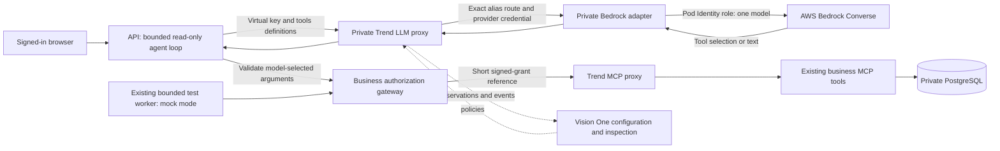

# Optional Bedrock deployment with Trend Gateway

**Consolidated locally; no live-model verification performed by this checkout.**
The imported second-deployment notes report a successful benign Nova Micro chat;
see [evidence and integration decisions](deployment-consolidation.md). That report
is separate from the original deployment, which was torn down after recovery capture. This option
adds a private adapter and enables real read-only travel chat only after explicit
activation. It does not switch to AgentCore or silently replace the mock fixtures.

Start with [the guide for coding agents](LLM_GUIDE.md) for the entire repository.



[Editable diagram](architecture/12-aws-bedrock-option.mmd).

## What is automated

`scripts/trend_bedrock.py` provides:

| Command | Behavior | AWS/model calls |
|---|---|---|
| `plan` | Validate config and show limits; model may remain unset | None |
| `render` | Write IAM/Pod Identity/secret template, adapter manifest and exact Vision One checklist | None |
| `prepare` | Check existing cluster/account/model, create a reviewable CloudFormation change set; optionally execute it, synchronize private key and deploy disabled adapter | AWS administrative calls; no model invocation |
| `activate` | Require config + CLI acknowledgments; enable adapter and patch API to rebuilt image/Bedrock mode | AWS/Kubernetes changes; deployer makes no inference calls, but subsequent chats can charge |
| `rollback` | Disable adapter, then restore prior API template if unchanged since activation | AWS/Kubernetes changes; no new model call; in-flight calls may complete |

The add-on contains one service-account IAM role with `bedrock:InvokeModel` on one
exact in-region foundation-model ARN, an EKS Pod Identity association, and a
retained generated provider key in Secrets Manager. Only the adapter gets this
role. The API, gateway, tools and test worker do not receive Bedrock permissions.
No static AWS access keys or tenant API keys are rendered.

The adapter exposes an OpenAI-shaped API already understood by the Trend LLM
proxy, then translates to Bedrock Converse. This avoids depending on unverified
native Bedrock auth support in the installed Trend preview. Model requests still
traverse Trend. A new exact route keeps the working mock route separate.

## Current scope and limits

- Requires an existing single-copy AWS Trend deployment, fresh rebuilt Python
  image and configured EKS Pod Identity agent. It is an add-on, not a new foundation
  or fleet deployer. It changes the existing API backend when activated.
- First version supports **one in-region, on-demand foundation model** that supports
  Converse client-side tool use. Inference profiles, cross-region models and ARN
  inputs are rejected. Verify model availability, tool-use support and account
  eligibility before choosing a model; metadata alone does not establish access.
- Four model requests and three read-only tool executions per chat, 400 output
  tokens per chat model request, 50-second overall API deadline, two API chat slots.
  Only `search_hotels`, `get_hotel_details`, `get_my_bookings` are offered.
- API validates all tool selections before dispatch; rejects unknown tools,
  schema changes, duplicate IDs, identity/approval assertions and mutation tools.
  Business gateway still checks ownership, signed grants, expiry and approvals.
- Tool display data is projected through the existing safe presenter before being
  returned to the model. This is not yet a raw malicious-tool-prose attack harness.
- Adapter accepts only reviewed schemas, non-streaming requests, a fixed logical
  provider model and valid tool-result pairing. No direct-model/tool fallback.
  Its absolute request bound is 1024 output tokens; the chat client always uses 400.
- One adapter replica/process; one Bedrock call at a time; busy calls receive 429.
  Default 60 attempted model requests per hour **per adapter process**, with no SDK
  retries. Five chats per synthetic traveler per minute in API memory. These limits
  reset on restart and are not a shared, durable budget or AWS dollar cap.
- Incomplete/truncated output and provider errors fail closed. Prompts, credentials
  and raw provider errors are not logged; token counts are returned and recorded
  as sanitized activity. Numeric usage is accounting, not a dollar cost estimate.
  An in-flight Bedrock call can complete after a client/API timeout; no new round
  starts after the overall deadline.
- The API changes to `MODEL_MODE=bedrock`; gateway/MCP services, bounded worker and
  isolated fixtures keep `MODEL_MODE=mock`. Standard monitor suites still queue
  on the mock worker. Each chat message starts a fresh bounded model/tool loop;
  cross-message conversation memory is not implemented. The opt-in dynamic fixture UI is unavailable in the active
  Bedrock API; roll back to mock for that experiment. Test-suite success does not
  certify the live Bedrock loop.

## Configuration

Copy `infra/trend-aws/bedrock.example.env` into the ignored private directory and
supply the existing deployment's account, operator principal, domain and CIDR.
Preserve its naming and credentials; do not provision a second foundation.

```dotenv
# Selected by the deployer after verifying supported tool use and in-region access.
BEDROCK_MODEL_ID=
BEDROCK_MAX_REQUESTS_PER_HOUR=60
BEDROCK_ENABLE_INFERENCE=false
# Keep this base/foundation flag unchanged in the private env file:
ENABLE_PAID_INFERENCE=false
```

`BEDROCK_ENABLE_INFERENCE` is the new activation opt-in. The base configuration
continues to refuse paid inference; activation explicitly patches only API/adapter
pod settings. Rendered adapter manifests always have paid inference disabled,
even if the deployment file requests later activation.

## Deployment procedure

These are operator commands, not instructions to an agent to spend money without
current user approval. The existing account uses the normal SDK/CLI credential
chain; do not embed a personal profile or automate interactive account login.

1. Set the private environment path and review an offline plan:

   ```sh
   BORING_ENV=infra/trend-gateway/private/bedrock.env
   .venv/bin/python -m scripts.trend_bedrock plan --env-file "$BORING_ENV"
   ```

2. Choose an available in-region model that supports tool use. Use AWS's model
   catalogue and your account's eligibility flow. `aws bedrock list-foundation-models
   --region <region>` is a read-only inventory call; do not invoke models to guess
   availability. This implementation deliberately does not auto-select a model.

3. Rebuild/publish the updated Python image through the existing sanitized image
   publisher. A fresh context directory and immutable tag are required:

   ```sh
   .venv/bin/python -m scripts.trend_aws_publish context --env-file "$BORING_ENV" --context build/bedrock-context
   # Authorized AWS write: capture the returned {"python": "...@sha256:..."} JSON privately.
   .venv/bin/python -m scripts.trend_aws_publish publish --env-file "$BORING_ENV" --context build/bedrock-context --component python --tag bedrock-reviewed-01 --apply
   ```

   Save that returned digest JSON to an ignored image file, represented below by
   `build/bedrock-images.json`. Do not reuse the running mock image: it predates
   the adapter code. Publishing an image does not activate the runtime.

4. Render and validate locally:

   ```sh
   .venv/bin/python -m scripts.trend_bedrock render --env-file "$BORING_ENV" --images-file build/bedrock-images.json
   cfn-lint build/trend-aws/DEPLOYMENT_NAME/bedrock-addon.json
   cfn-guard validate --rules infra/trend-aws/bedrock.guard --data build/trend-aws/DEPLOYMENT_NAME/bedrock-addon.json --output-format json
   ```

   Replace `DEPLOYMENT_NAME` with the plan's exact name. Review IAM scope, private
   service and generated `bedrock-vision-one-setup.md`. `cfn-lint` checks resource
   properties; the included Guard rules check selected project constraints, not
   all security/compliance concerns. AWS account-aware validation happens with the
   change set and can still fail. Review IAM/CloudTrail audit coverage before apply.

5. Create the change set for review, then explicitly execute/resume preparation:

   ```sh
   .venv/bin/python -m scripts.trend_bedrock prepare --env-file "$BORING_ENV" --images-file build/bedrock-images.json --apply --acknowledge-costs
   # Review the returned CloudFormation change set, then:
   .venv/bin/python -m scripts.trend_bedrock prepare --env-file "$BORING_ENV" --images-file build/bedrock-images.json --apply --acknowledge-costs --execute-change-set
   ```

   Pending change-set ownership is recorded in an ignored local ledger. Completed
   stacks must have matching ownership/model. Model changes require a separately
   reviewed IAM stack update; the script does not silently overwrite it.
   Preparation preserves MCP/mock credentials, merges the Bedrock alias, excludes
   the adapter from the broad same-namespace policy, then installs its narrower
   gateway-only ingress policy. It permits DNS, public TLS egress and the EKS Pod
   Identity agent address. This is not an FQDN egress filter. Do not apply the
   rendered adapter alone and assume it removes additive existing policies.

6. Complete the **one-time Vision One checklist** generated in the build directory.
   Provider URL is private `bedrock-adapter.<namespace>.svc.cluster.local:8000`;
   provider type OpenAI; provider model `boring-travel-bedrock`; requested-model
   label `<namespace>-bedrock-chat`; alias/provider `<namespace>-bedrock`.
   Grant scoped identity access and assign request/response inspection. The provider
   key filename is generated; no credential value is needed in chat. Gateway
   LLM listener 8080 must be enabled. New filename clients may need a scoped gateway
   reload; confirm catalogue/readiness before paid testing. Supported Vision One
   management API automation remains unverified; no undocumented endpoints used.

7. After review/approval, set `BEDROCK_ENABLE_INFERENCE=true` in the private file.
   Activation requires both explicit acknowledgments:

   ```sh
   .venv/bin/python -m scripts.trend_bedrock activate --env-file "$BORING_ENV" --images-file build/bedrock-images.json --apply --acknowledge-costs --acknowledge-model-charges --vision-one-configured
   ```

   The console flag is an operator assertion, not automatic proof of configuration.
   The script stores the previous API template, enables the adapter, patches the
   API image/mode and waits for readiness. **Subsequent authenticated chat requests
   can now incur model charges.** It sends no automatic inference probe.

8. Use one benign hotel-search chat, verify model usage, actual tool authorization,
   readable response and matching Vision One Events. Verify own-booking access and
   cross-owner/mutation denial separately. Confirm no mocks or direct SDK fallback
   were used. Real tool selection and effective content inspection remain live
   acceptance cases until evidenced. Do not call old mock results real inference.

## Rollback and retained resources

```sh
.venv/bin/python -m scripts.trend_bedrock rollback --env-file "$BORING_ENV" --apply --acknowledge-costs
```

Keep the private activation ledger. Rollback disables the provider, waits for its
rollout and restores the exact prior API template when it has not changed since
activation. Partial failures are recorded. If the API changed externally, provider
inference is disabled and the script refuses to overwrite that API change; inspect
manually. In-flight Bedrock calls may complete and be billed. Rollback preserves
the adapter, IAM stack and retained secret; it does not stop base hosting charges.
Do not run `prepare` over active Bedrock API; roll back first. If a ledger is lost,
review current API/adapter state before attempting recovery. No automatic teardown.

## Evidence and references

The complete offline suite passed **287 tests**, including **30 Bedrock cases**.
Offline tests use Botocore Stubber and an HTTP mock transport; **no live Bedrock
calls or AWS mutations were made during implementation**. They cover real Converse
request serialization, provider failure sanitization, auth/activation gates, reviewed
schemas, ID pairing, read-only dispatch, identity spoofing, numeric usage, request
limits, IAM scope, credential merging, additive network-policy exclusion, safe
activation and rollback drift protection.

Local cfn-lint and three repository Guard rules passed. AWS service validation,
Pod Identity credential delivery, tenant route/inspection, real model compatibility,
latency, pricing and end-to-end deployment are not verified by these offline checks.
Existing dynamic new-tool gateway denial failure remains open; adding Bedrock does
not fix it. See [current issue register](aws-deployment-issues.md).

- [Bedrock client-side tool use](https://docs.aws.amazon.com/bedrock/latest/userguide/tool-use-client-side.html)
- [Converse API](https://docs.aws.amazon.com/bedrock/latest/userguide/conversation-inference.html)
- [EKS Pod Identity](https://docs.aws.amazon.com/eks/latest/userguide/pod-identities.html)
- [Vision One resources](https://docs.trendmicro.com/en-us/documentation/article/trend-vision-one-AIG-resources)
- [Vision One controls](https://docs.trendmicro.com/en-us/documentation/article/trend-vision-one-AIG-controls)
