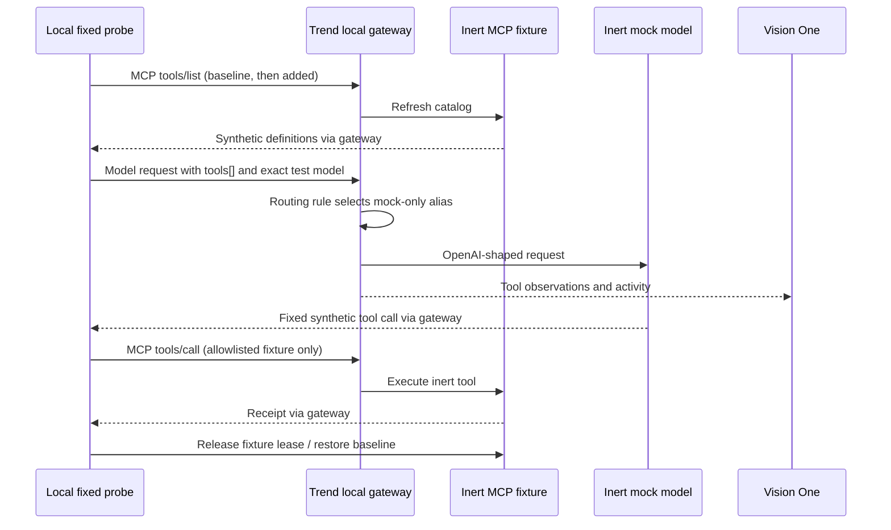

# Local model-routing discovery test — 2026-10-22

**Passed:** Vision One Discovered Tools now contains `fixture_status` and
`fixture_new_tool`, each with one call. Both model requests returned HTTP 200;
the mock provider and MCP fixture independently recorded the expected calls.
Fixture state was restored. No AWS operations or paid inference occurred.
[Sanitized evidence](model-discovery-verification.json).

## What changed our diagnosis

The earlier direct MCP traffic produced Events but no Discovered Tools entries.
This test supplied MCP-derived tool definitions in an OpenAI-shaped model request
through Trend's LLM proxy. The inventory then populated. This establishes a working
local path on gateway 0.1.159; it does not prove model routing is universally
required for every MCP inventory path or establish a vendor defect.

Routing selects the provider; the submitted tool definitions are the new evidence
being observed. The baseline tool appeared even after an initial provider 404,
before successful inference. Observation therefore does not mean execution or
permission approval. The later successful phases established execution separately.

The new tool appeared after an explicit catalog refresh and submission of its
schema in the second model request. This does **not** establish automatic server
push discovery, `listChanged` notifications, discovery of tools absent from model
requests, real-model attack susceptibility, or Trend blocking. The production
travel tool allowlist is unchanged and does not auto-approve observed tools.

## Flow



## Components and safety bounds

- `services/mock_model_provider.py`: authenticated private provider, fixed prompt,
  fixed model, exact fixture schemas, two allowed tool names, no callbacks or
  outbound client, no model SDK. Zero token usage is synthetic, not a billing API.
- `scripts/model_discovery_probe.py`: baseline/addition phases, no arbitrary input,
  no direct-provider fallback, validates both provider and backend receipts,
  restores state in `finally`, reports nonzero exit on failure. Its JSON deliberately
  leaves `inventory_verified=false`: only independent console review can set that
  finding in the separate checked-in evidence record.
- `compose.model-probe.yaml`: no host model port; private worker return link to
  gateway port 8080 through a kind-network-only NodePort 30080. No host port mapping
  is added. Mock key is separate from the application virtual key and fixture key.
- Existing identities, shared guardrails and travel access policies were retained.
  The application remains scripted; this is a separate diagnostic CLI, not a new
  monitoring-button suite or a production chatbot model integration.

## Reproduce on an already enrolled local gateway

Requires the private Trend/worker/tool-change configuration described in
[tool-changes.md](tool-changes.md). It deliberately does not enroll a new tenant,
log in to AWS, provision a paid model, or download credentials.

1. Run `python -m scripts.tool_changes_setup`. It creates missing ignored key files
   with mode 0600 and preserves existing ones, including `mock-model-key`.
2. Add that mock-only key to a Kubernetes Secret projected under
   `/etc/secrets/gateway/` in the local gateway. Use a private `--from-file` workflow;
   never paste key values into chat, command arguments, docs or the console.
3. Apply `infra/trend-gateway/model-probe-nodeport.yaml` to the existing local kind
   cluster. Upgrade the existing pinned local Helm release with `--reuse-values`
   and `infra/trend-gateway/model-probe-values.yaml`; this enables `llm_proxy` while
   preserving existing MCP/auth/policy settings. Back up values privately first.
4. Start the Compose overlays below. Inspect the mock container's address on the
   `trend-kind` network; the test used `172.20.0.7`, which is not portable. Do not
   copy that address into an AWS deployment or expose the mock publicly.
5. In Vision One create an OpenAI provider `dannytran-local-mock`, base URL
   `http://<current-private-mock-address>:8000` **without `/v1`**. Use a platform
   secret file reference to the projected mock key. Add model
   `dannytran-mock-model` manually, attach it to alias `dannytran-local-tools`, then
   create enabled rule `dannytran-local-tool-discovery` matching **only** requested
   model `dannytran-tool-discovery-probe`, targeting that alias. No wildcard or
   fallback aliases. Do not choose a real provider.
6. Verify configuration propagation before sending the probe; a local gateway
   restart was needed in this run. Check the newest non-terminating pod's readiness.
   Run the fixed probe command below.
7. In Discovered Tools use Provider/Model/Alias = All. Verify both names and call
   counts independently, then correlate LLM and MCP Events with the receipt time.
   If a console refresh leaves the panel blank, opening the AI Application Security
   main page and navigating back through AI Gateway recovered it during this test.

```sh
# Run from the repository root. These are local Docker operations.
# Use this complete overlay list for both start and execution.
docker compose --env-file infra/trend-gateway/private/trend-test.env \
  -p boring-travel-trend \
  -f compose.yaml -f compose.trend-test.yaml \
  -f compose.test-runner.yaml -f compose.test-runner-trend.yaml \
  -f compose.tool-changes.yaml -f compose.tool-changes-trend.yaml \
  -f compose.model-probe.yaml up --build -d --wait

docker compose --env-file infra/trend-gateway/private/trend-test.env \
  -p boring-travel-trend \
  -f compose.yaml -f compose.trend-test.yaml \
  -f compose.test-runner.yaml -f compose.test-runner-trend.yaml \
  -f compose.tool-changes.yaml -f compose.tool-changes-trend.yaml \
  -f compose.model-probe.yaml exec -T test-worker \
  python -m scripts.model_discovery_probe
```

## Setup failures resolved, without bypassing authentication

The published provider file reference initially ended in `dannytran-local-moc`.
We verified that exact path and projected the same mock-only key under that alias;
the normal filename `dannytran-local-mock` also exists. No cause is established for
the shortened UI value. A missing provider key produced HTTP 400 `no upstreams
configured`. A base URL ending `/v1` produced `/v1/v1/chat/completions` and HTTP 404;
using the root URL corrected it. One probe during gateway restart stopped before
catalog initialization; after readiness, both phases passed. These were setup
failures, not evidence of a vendor security block.

## Validation and current state

227 unit cases passed; Ruff lint and formatting passed. New cases cover private
provider authentication, both fixed tool responses, rejection of arbitrary models,
prompts, tools, schemas, streaming, duplicates and callback fields; cloud/disabled
activation refusal; private fresh-key preparation and preservation. Fixed the
pre-existing setup helper's unsupported `Path.open(opener=...)` usage by using
built-in `open`, covered by the fresh-directory test.

The local Trend app (8082), fixture/reference preview (8085), kind gateway, mock
provider and private return link remain running for review. The LLM proxy and
exact mock-only route remain enabled; no real-model alias or fallback was added.
No broader teardown or cloud verification was performed. To retire this diagnostic,
disable its exact console route, stop/remove only the two probe services, delete
only `dannytran-local-llm-probe`, and restore the prior LLM-enabled flag with a
narrow Helm values update. Preserve existing MCP services, private files and data.
The user authorized publishing this experiment on `working-edition`; consult Git
history for the resulting commit. `main` is outside the change scope. Earlier
discovery findings remain historical evidence.
