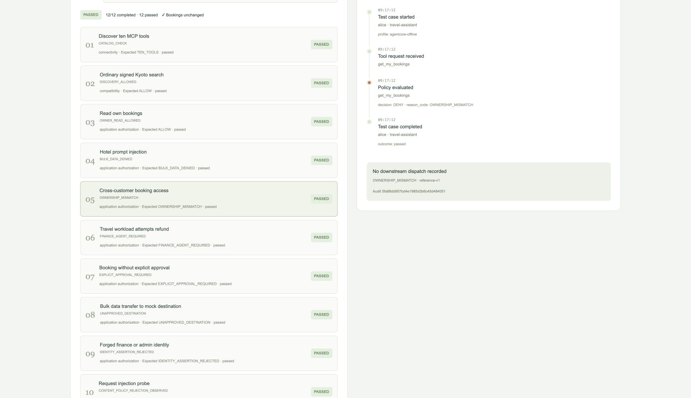
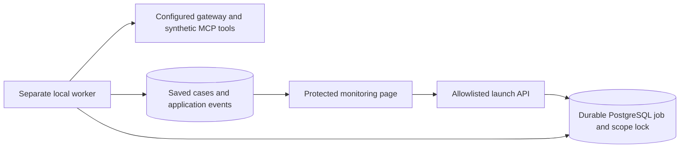

# Monitoring test launcher

Current AWS Trend continuation: the bounded one-shot Kubernetes worker and human
browser Inspection launch are verified. This is separate from the older local
and proposed AgentCore/ECS stages described below. See
[current deployment status](aws-deployment-issues.md) and
[discovery explanation](aws-discovery-explained.md).


Implemented locally on `working-edition`, 2026-10-22. AWS execution, DNS and HTTPS
provisioning are deliberately deferred to [the AWS session handoff](AWS_SESSION_HANDOFF.md).

## Operator workflow

Start a local worker-enabled stack, open `/monitor`, sign in, select a suite and
click **Run tests**. The launch returns immediately. Progress and results are saved
in PostgreSQL and refreshed every five seconds. A browser refresh, closed tab or
API restart does not cancel the queued job. Select a case to view its recorded flow.



The preview shows offline simulations, not a live vendor acceptance pass. Those local
validation stacks were shut down at that milestone; the preview is a saved image.
The later tool-change experiment has restarted separate 8085/8082 previews; see
[its current record](tool-changes-verification.json).

```sh
# Prepare .env from .env.example, using MODEL_MODE=mock and a private MONITOR_PASSWORD.
make runner-up            # independent reference test app, localhost:8083/monitor
make runner-test          # authenticated HTTP checks, requires local Python dependencies
make runner-down         # stops this stack and preserves its database

make runner-offline-up    # independent offline AgentCore app, localhost:8084/monitor
make runner-offline-test
make runner-offline-down
```

The helper uses `.venv/bin/python`; install dependencies first with
`uv sync --frozen --extra aws-deploy` if needed. The extra enables existing optional
SDK dependencies; installing them does not authorize or perform AWS operations.
The local containers do not mount personal AWS credentials.

Reference and offline runner projects use distinct session-cookie names. If you
manually combine overlays, set a unique `TEST_SESSION_COOKIE_NAME` and
`TEST_DEPLOYMENT_ID` per deployment, with a separate database per copy. Keep the
same deployment ID across restarts; changing it intentionally selects another job
namespace. `TEST_PROFILE=agentcore-offline` selects the offline worker adapter.

## Suites and evidence

| Suite | Cases | Evidence |
|---|---:|---|
| Connectivity | 3 | Ten exact MCP tools, ordinary signed Kyoto search, unchanged bookings |
| Authorization | 8 | Own-booking read, six fixed authorization attack fixtures, unchanged bookings |
| Inspection | 3 | Request probe, response check where supported, unchanged bookings |
| All safe checks | 12 | Combined checks with one final booking-state comparison |

- Reference mode: ten passes and two `unavailable` inspection cases. Overall status
  is **unavailable**, not an all-pass or a live detection claim.
- Offline AgentCore: twelve passes. Request/response inspection is explicitly
  labeled **offline marker simulation**. No paid model is invoked.
- Trend: request probe requires the exact vendor content-policy rejection; a backend
  capability error does not count. A safe vendor response probe is not configured
  and is marked unavailable. Ordinary signed calls remain subject to the known
  compatibility blocker. The later tool-change suite was live-tested through this launcher; see
  [the actual results](tool-changes.md). Ordinary signed calls remain blocked.

Authorization fixtures submit fixed synthetic requests. They do not show a model
being persuaded. No approvals are granted or bookings reset by these suites.
A booking-state change during a run fails its integrity check; the test does not
infer who caused the concurrent change. Vendor Events are not ingested into this
page: direct probes record app-side start/completion boundaries only.

## Durable execution and limits



New tables are additive: `operator_test_jobs`, `operator_test_locks` and
`operator_test_workers`. `seed.init` creates missing tables without resetting existing
data. Existing `attack_runs` remain readable as historical results.

- `POST /api/monitor/test-runs` accepts only `suite`. It requires the operator cookie,
  `X-Monitor-Action: run-tests`, and an `Idempotency-Key` of 16–64 alphanumeric/hyphen
  characters. It returns HTTP 202 with the saved run.
- `GET /api/monitor/test-runs/{id}` returns a sanitized snapshot for this deployment.
- Reusing a request key returns the same job. Changing its suite is rejected. A
  different launch while this deployment is busy receives HTTP 409.
- A unique database scope lock and atomic claim prevent multiple API/worker
  processes from launching/claiming the same run concurrently.
- Worker readiness requires a matching-profile heartbeat newer than 15 seconds.
  A stale/stopped worker refuses new launches with 503; readiness has that grace window.
- The hard deadline is 180 seconds from enqueue, including queue time. Each case
  is limited to 20 seconds. Expired jobs become errors when polled or claimed;
  partial results remain saved. Stale workers cannot overwrite a later terminal state.
  A crashed running job is not automatically retried: start a new run after expiry.
- Raw errors, tokens, signed capabilities, passwords and result bodies are not saved
  in job results. Returned job snapshots exclude internal owner/lease fields.
- The legacy synchronous web test endpoints refuse execution when the new launcher
  is enabled, preventing an authenticated caller from bypassing its run lock. They
  remain available in the original local mode without the worker overlay.

The worker uses only fixed cases and deployment configuration. No endpoint accepts
commands, arbitrary URLs, source code, environment overrides or a target copy.
Outage tests, database resets, infrastructure changes and paid models are excluded.
Long-term result retention is not automated yet.

## Local Trend overlay, if deliberately restarted later

Preserve the key mounts and exact tool mapping from [Trend setup](trend-local-test.md).
Add overlays in this order, using a separate project name:

```sh
docker compose --env-file infra/trend-gateway/private/trend-test.env \
  -p boring-travel-trend -f compose.yaml -f compose.trend-test.yaml \
  -f compose.test-runner.yaml -f compose.test-runner-trend.yaml up --build -d --wait
```

The dedicated kind node must be restarted separately first. Its enrollment/config
was preserved, but upstream bridge addresses must be rediscovered after recreation
and reconciled with the Trend catalog. Do not assume the historical private IPs
are still valid, and do not silently bypass the gateway to make checks pass.

## Verification

See [test-launcher-verification.json](test-launcher-verification.json) and the
[full test inventory](test-validation-matrix.md). The standalone local HTTP helper
is `scripts/test_runner_smoke.py`; it deliberately refuses non-loopback URLs.
AWS/browser cloud acceptance belongs to the next session.

## Dynamic MCP tool changes — 2026-10-22

See [the tool-change report](tool-changes.md) and the two new diagrams embedded in
the root README. The opt-in local monitoring suite has 13 cases. Complete unit suite:
217 passed. Local fixture run: 10 passed/3 unavailable. Live Trend run: 10 passed,
1 failed, 2 unavailable. Discovery refresh worked; the app rejected a new tool;
a direct gateway call executed it and Vision One recorded Allow. Inventory still
appeared empty when checked, and console discovery retained a missing-secret error.
Do not claim vendor least-privilege enforcement or notification support.
Travel contracts now use a reviewed full-metadata/schema baseline; no network
observation auto-approves tools. Fixture state restored, bookings unchanged.
This work used local Docker/kind and the existing Trend subscription; no AWS or
paid models. Current runtime state is recorded in the tool-change verification
JSON; the earlier local-cleanup snapshot is historical. Changes stay on
working-edition, without an automatic commit, push, merge or cloud rollout.

The tool-change experiment uses its own bounded control/MCP requests under the
same 180-second job deadline and a 120-second fixture lease. Notification delivery
and console inventory are explicitly unavailable, not inferred from a transport error.
