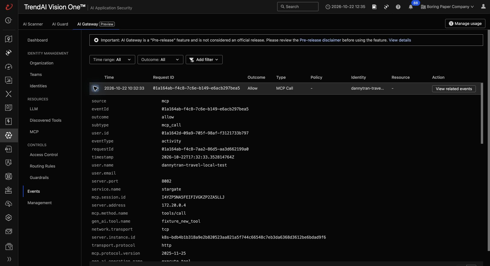
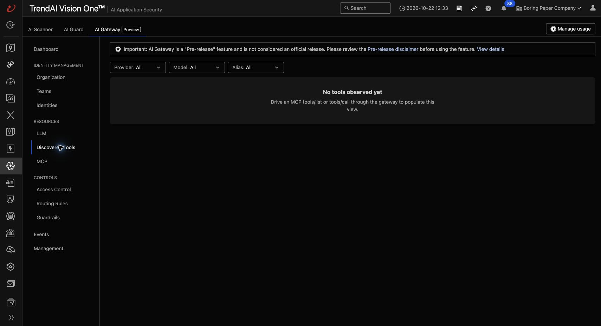
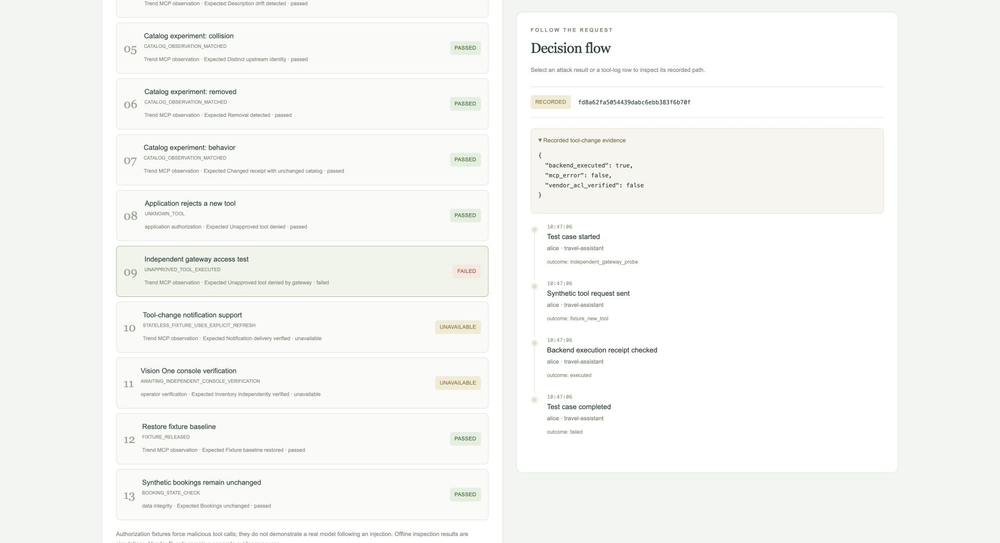

# Dynamic MCP tool-change experiment

Implemented and locally tested on `working-edition`, 2026-10-22. No AWS operations
or paid inference. The assistant remains deterministic. This experiment does not
establish model susceptibility or general attack prevention.

## Results

| Layer/case | Observed result |
|---|---|
| Local fixture suite | 10 passed, 3 unavailable; overall unavailable, deliberately not all-pass |
| Actual Trend MCP suite | 10 passed, 1 failed, 2 unavailable; overall failed |
| Add/remove/schema/description/name collision | Explicit refresh in an existing and a fresh session observed the expected catalog changes through Trend |
| Same name and advertised contract, changed implementation | Catalog hashes stayed identical; synthetic receipt showed changed behavior |
| Application unknown tool | `UNKNOWN_TOOL`, no downstream dispatch |
| Direct Trend call to `fixture_new_tool` | Executed; expected unapproved-tool denial failed |
| Vision One activity | Independent console record shows MCP `tools/call`, `fixture_new_tool`, `allow`, empty arguments and the inert receipt |
| Vision One inventory | Discovered Tools still said “No tools observed yet” when checked; no successful inventory-population claim |
| Active console discovery | Still reports a missing platform-secret file; associated tool count remains zero |
| Notifications | Unavailable: stateless fixture uses explicit `tools/list`; no notification forwarding claim |
| Cleanup/data integrity | Lease released, fixture restored, synthetic bookings unchanged |

The vendor event was observed at `2026-10-22T17:32:33.352814764Z`, event
`01a164ab-f4c8-7c6e-b149-e6acb297bea5`, request
`01a164ab-f4c8-7aa2-86d5-aa3d662199a0`, identity
`dannytran-travel-local-test`. This supports an allowed synthetic call, not a
particular ACL policy evaluation. Existing content inspection scoped to the three
travel upstreams does not establish coverage for this fourth fixture upstream.
We did not change shared policies, create credentials in Vision One, or auto-approve tools.





The automated run retains `vision_one_verified=false` and an unavailable console
case: there is no console-ingestion API integration. The independent observations
above are a dated report, not an automatic pass applied to later runs.



Machine-readable [verification and current runtime](tool-changes-verification.json).
The two local previews and kind gateway are left running for review; original
8080/8081 profiles remain stopped. Both fixture catalogs are restored. Changes
are maintained on `working-edition`; consult Git history for publication status.
No AWS operation was performed.

## Architecture and safeguards

See README diagrams and editable [architecture](architecture/07-dynamic-mcp-tool-tests.mmd)
and [sequence](architecture/08-dynamic-mcp-observed-flow.mmd) sources.

- `services/tool_change_fixture.py` is a separate inert MCP server with seven
  allowlisted states: baseline, added, schema, description, collision, removed,
  behavior. It imports no database or travel tool runtime and cannot execute code,
  access travel records, call models, or accept arbitrary tool definitions.
- Control and MCP traffic use separate private file-backed keys. The control key
  is mounted only in the fixture and worker, never the API/frontend/gateway.
  No fixture/control port is published. The Trend bridge exposes only MCP, not control.
- A random owner token holds the fixture for at most 120 seconds. Another run cannot
  acquire/reset it. `finally` restores baseline; after a crash, the next request
  checks expiry and restores it before accepting work. State and receipts are
  in-memory and reset on fixture restart. Use one fixture process/replica.
- The existing durable job lock, monitor authentication, action header, retry key,
  heartbeat, mock-model guards and 180-second run deadline apply. The experiment
  is opt-in, requires `TOOL_CHANGES_ENABLED=true`, and is excluded from `all`.
- `services/tool_catalog.py` hashes the complete advertised contract/metadata with
  canonical JSON object ordering. An empty description and an absent description
  normalize to the same contract, matching the observed Trend representation;
  substantive description changes still cause drift. Key is upstream plus tool identity in the
  configured mapping. A duplicate identity is rejected. Array reordering is
  conservatively drift; hashes cannot reveal implementation changes.
- `services/approved_trend_catalog.json` pins reviewed travel tool metadata and
  complete input/output contracts. The Trend adapter rejects known-tool drift
  before the business gateway dispatches. Unknown mappings remain forbidden and
  upstream descriptions never become trusted agent instructions. Baselines are
  code-reviewed files, never learned from network traffic. The reviewed catalog also passed live connectivity after this normalization; legitimate signed travel calls have a separate existing
  vendor compatibility blocker.
- Results contain fixed names, hashes, booleans, safe timestamps and reason codes.
  SDK error text, keys, signed capabilities, raw vendor bodies and untrusted
  descriptions are not persisted. Flow events record actual catalog/dispatch/receipt
  boundaries; they are application observations, not fabricated vendor events.

## Start and run locally

```sh
make tool-changes-setup
make tool-changes-up
# http://localhost:8085/monitor
# Use MONITOR_PASSWORD from the ignored private/tool-changes.env locally.
# Choose Tool changes (isolated experiment), then Run tests.
make tool-changes-test
make tool-changes-down
```

The setup helper generates missing private credentials and a new local database/
monitor password; it never replaces existing files or registers anything externally.
It creates an empty private mapping file to satisfy the Compose secret reference;
the reference route does not read that mapping. Starting does not reset existing
volumes. `down` preserves this test database and saved runs.

The smoke helper checks authentication, all 13 results, saved flows, restoration and
booking integrity, then prints **launcher_protocol** separately from
**security_acceptance**. It writes sanitized results under ignored `build/trend/`.
A working launcher with a failed access test must never be described as all-pass.

## Live local Trend setup

Use the previously enrolled local kind gateway and private files from
[Trend setup](trend-local-test.md). Do not use personal AWS credentials or deploy
cloud resources. After deliberate local startup:

```sh
docker start boring-travel-control-plane
docker compose --env-file infra/trend-gateway/private/trend-test.env \
  -p boring-travel-trend -f compose.yaml -f compose.trend-test.yaml \
  -f compose.test-runner.yaml -f compose.test-runner-trend.yaml \
  -f compose.tool-changes.yaml -f compose.tool-changes-trend.yaml up --build -d --wait
.venv/bin/python -m scripts.tool_changes_smoke --profile trend
```

Register only the inert upstream `dannytran-tool-changes` in Vision One. Obtain its
current kind-network bridge address; do not reuse this report's IP blindly. Use
`http://<fixture-bridge-ip>:8082/mcp`, HTTP, platform-file authentication, custom
header `X-MCP-Service-Key`, empty scheme. Mount the upstream key in the local kind
secret without displaying the value. In this run, the returned configuration
requested `/etc/secrets/gateway/dannytran-tool-change` (singular), despite the plural
upstream name. Both singular and plural filename aliases were projected. Kubernetes
file projection is asynchronous; the local gateway was restarted after verifying
file presence. Local proxy discovery then worked, while console discovery retained
its missing-file error. Do not infer a cause or disable authentication to work around it.

Save the exact names observed through the gateway in ignored
`build/trend/tool-change-map.json`, as an object with `upstream_prefix` (the exact observed namespace, not a guessed
separator) and `tools` containing canonical keys `fixture_status`,
`fixture_new_tool`, `search_hotels`. Every mapped name must match that namespace
and canonical suffix. Previously unmapped names within the namespace remain
visible to drift detection, without becoming approved application tools. Do not guess separators or
point the collision entry at the real travel-discovery tool. Briefly advertise
added/collision states under an owned control lease to observe exact fixture names,
then release the lease before launching the suite. The mapping is transport
configuration for this inert experiment, not approval for the travel assistant.

Docker reused the old travel bridge IP for the fixture bridge in this session.
The fixture bridge forwards only the three exact historical travel MCP paths to
`trend-mcp-bridge`, which still checks its upstream key. Other paths, including
control, return 404. On a different installation, reconcile registered URLs against
actual bridge addresses; do not assume Docker placement is stable.

The fixture uses the existing local test identity and application key. No new
virtual key, model routing rule, broad access rule or shared guardrail policy was
created. Existing inspection was not bypassed. The original app/offline profiles
are unchanged. AWS integration belongs to the separate session handoff.

## Remaining acceptance work

1. Resolve Vision One console active-discovery/inventory behavior with the vendor;
   compare server-side MCP inventory with any model-function-specific inventory behavior.
   Do not enable paid model traffic merely to populate a screen.
2. Configure a narrow deny-by-default tool access policy for the test identity/
   fixture, preserve one approved baseline tool, rerun direct calls, and match
   vendor deny events. A transport error or content denial alone is not ACL proof.
3. Test notification delivery with a stateful server and supported client/gateway
   configuration. This fixture intentionally advertises no change notifications.
4. Revisit ordinary signed travel-call compatibility independently; the inert
   fixture has no signed business capability and its success cannot resolve that issue.
5. Extend AWS worker authorization/dispatch through the existing handoff; no AWS
   hosting, DNS, fleet deployment or paid model testing was done here.

## Follow-up inventory diagnosis

The later [focused diagnosis](trend-discovery-diagnosis.md) verified a fresh cloud
`tools/list` event, healthy delivery, empty inventory with All filters, and a console
credential-file failure despite the exact local file being present. It separates
confirmed failures from likely preview/reporting issues; no exact vendor root
cause or model-routing prerequisite has been established.
