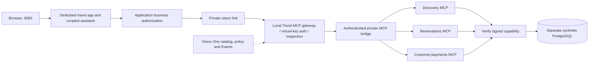

# Local Trend MCP integration and acceptance results

Tested 2026-10-22 against local Trend gateway v0.1.159. Changes based on
`working-edition` base commit `d32d9ca`; the local integration and evidence are
maintained on that branch.
Machine-readable result: [trend-local-verification.json](trend-local-verification.json).
No AWS deployment or paid model inference occurred. Vision One supplies the live
catalog, policy and activity backend under the user's existing license.

## Result

Transport is implemented and all ten tools are discovered. Before adding the scoped
inspection assignment, hotel requests and the existing deterministic chat smoke
passed, including persona isolation, cross-owner denial and unchanged bookings.
After assigning request/response inspection, **normal signed app requests fail
closed**. This is not a successful full application acceptance test.

| Test | Observed result |
|---|---|
| Missing and invalid application key | HTTP 401 |
| Authenticated local `tools/list` | Ten tools across three upstreams |
| Benign `search_hotels`, no capability | Backend rejects missing/invalid capability |
| Synthetic injection in `destination`, no capability | Trend reports `tool call blocked by content policy (request)` |
| Vendor Events | Scoped assignment Deny, `prompt_attack.default.classifier (high)`, request surface |
| Benign app Kyoto/hotel/bookings reads after assignment | HTTP 503 `ENFORCEMENT_UNAVAILABLE`; vendor request denials |
| Full integration runner after assignment | Stops at first hotel-list request, HTTP 503 |
| Original 8080 and offline AgentCore 8081 health | HTTP 200 |
| Unit suite and Ruff | 170 cases passed; one existing TestClient deprecation warning; lint passed |

A benign unsigned request reaches the backend, while a legitimate signed request
is classified as an attack. This points to the signed capability within inspected
arguments as a compatibility problem; a controlled same-arguments comparison and
vendor-supported solution are still needed. Do not remove the capability, skip
inspection, relax the existing shared policy, or add a direct-backend fallback.
The single blocked injection is not proof of general attack protection or real-model
susceptibility. The assistant remains scripted.

## Separate request path


[Observed test flows](architecture/06-trend-inspection-test-flows.png) distinguish
vendor inspection from backend authorization.



Original app 8080 and offline AgentCore 8081 retain their existing projects, databases
and cookies. Only `boring-travel-trend` uses this overlay. Business ownership,
approval and idempotency remain app controls, not assumed Trend features.

## Prerequisites and private files

Use the already enrolled `kind-boring-travel` cluster, namespace `trendai-gateway`,
release `trendai-gateway`. This overlay does not install/enroll the vendor gateway.
Do not apply it to the original Compose project. Keep `.env` in mock/local mode.

Ignored owner-only files:

- `infra/trend-gateway/private/travel-virtual-key`: raw AI Gateway application key,
  not a Vision One tenant API key or bootstrap token.
- `infra/trend-gateway/private/travel-upstream-key`: generated URL-safe upstream key.
- `infra/trend-gateway/private/trend-test.env`: generated monitor password,
  `PUBLIC_PORT=8082`, `MODEL_MODE=mock`, independent `TREND_MCP_SIGNING_KEY`, and
  `TREND_LOCAL_UID`/`TREND_LOCAL_GID` matching the local owner. Never print this file.
- `build/trend/tool-map.json`: exact canonical-to-vendor-name mapping obtained from
  authenticated local discovery. The client requires complete, unique names for
  each selected server; it will not guess a delimiter or fall back.

Prepare these files privately before starting a fresh installation; use different
signing and monitoring secrets from other stacks. Set owner-only permissions.
No secret belongs in shell arguments, docs, Git, browser-facing settings or images.
The isolated DB was initialized with the local synthetic-only DB credential; changing
that environment value later does not rotate an existing database password.

The Kubernetes Secret `dannytran-travel-mcp-upstream` contains the upstream key under
`key` and each of the three upstream names below. Create/update it using `kubectl
create secret generic --from-file=...` with the private key file, never an inline
literal. `test-upstream-secret-values.yaml` mounts it; apply to the enrolled release
using `helm upgrade --reuse-values` and the pinned chart. Do not use the historical
upgrade example without these values, because it would remove the new mounts.
Apply `test-nodeport.yaml` to expose only the MCP proxy inside the kind Docker network.
The return link targets `boring-travel-control-plane:30081`; adjust that local node
name if your kind cluster differs. No host port is published by the bridge/NodePort.

## Console resources created

| Resource | Value |
|---|---|
| Service-account identity | `dannytran-travel-local-test` |
| Application key name | `dannytran-travel-local-mcp` |
| MCP upstream names | `dannytran-travel-test-discovery`, `dannytran-travel-test-reservations`, `dannytran-travel-test-customer-payments` |
| Upstream transport/auth | HTTP; platform secret file; custom header `X-MCP-Service-Key`; empty scheme |
| Secret paths | `/etc/secrets/gateway/<upstream-name>` |
| Scoped guardrail assignment | `dannytran-travel-local-mcp-inspection` |
| Content policy | Existing `Boring-Travel-AI`, unchanged; request + response; only new identity and three upstreams |

The new bridge's current kind-network IP was `172.20.0.4`. Obtain it again after
recreation rather than copying that address into a reusable deployment script:

```sh
docker inspect boring-travel-trend-trend-mcp-bridge-1 --format '{{(index .NetworkSettings.Networks "kind").IPAddress}}'
```

Register `http://<bridge-ip>:8082/travel-discovery/mcp`, `/reservations/mcp` and
`/customer-payments/mcp`. The namespaced tool names observed here are
`<upstream-name>__<canonical-tool-name>`; verify actual names rather than infer them.
The console Discover tools action still reports a missing secret file, although the
local MCP proxy discovers ten tools successfully. Associated tools remain zero in
the console. Explicit vendor per-tool access-control rules are **not configured**;
default tenant access allowed discovery. That is not a least-privilege acceptance pass.

## Reproduce checks

From repository root, start only this project (private prerequisites must exist):

```sh
docker compose --env-file infra/trend-gateway/private/trend-test.env -p boring-travel-trend -f compose.yaml -f compose.trend-test.yaml up --build -d --wait
```

For a **new empty test database only**, seed the synthetic records:

```sh
docker compose --env-file infra/trend-gateway/private/trend-test.env -p boring-travel-trend -f compose.yaml -f compose.trend-test.yaml exec -T travel-discovery python -m services.seed
```

Run a temporary loopback MCP port-forward in a separate terminal:

```sh
kubectl --kubeconfig infra/trend-gateway/private/kubeconfig --context kind-boring-travel -n trendai-gateway port-forward --address 127.0.0.1 svc/trendai-gateway-gateway 18081:8081
```

Export only non-secret file paths and local routing configuration:

```sh
export APP_MODE=local ENABLE_TREND_GATEWAY=true
export TREND_MCP_URL=http://127.0.0.1:18081/
export TREND_VIRTUAL_KEY_FILE=infra/trend-gateway/private/travel-virtual-key
export TREND_TOOL_MAP_FILE=build/trend/tool-map.json
.venv/bin/python -m scripts.trend_probe
.venv/bin/python -m scripts.trend_smoke
```

`trend_probe` checks authentication, ten schemas, unsigned backend rejection and one
synthetic content denial. Confirm matching Vendor Events separately. `trend_smoke`
requires legitimate signed calls to pass; **currently fails**, correctly reporting the
503 compatibility blocker. Once resolved, run:

```sh
CHAT_BASE_URL=http://localhost:8082 CHAT_COMPARE_BASE_URL=http://localhost:8080 .venv/bin/python -m scripts.chat_smoke
.venv/bin/python -m scripts.trend_outage
```

The outage script stops only this project's return-link container and restores it
in `finally`; it checks no booking mutation during an approved request, a 503 during
outage and recovery. It has **not been run** because its benign baseline is blocked.
The monitor page uses the private generated password; it shows application evidence,
not a merged vendor-event feed. The scenario button intentionally remains disabled
for this profile until vendor-specific acceptance semantics are implemented.

## Next acceptance gates

1. Reproduce signed versus unsigned ordinary arguments and obtain a supported way
   to keep authorization metadata separate from inspected content. Do not tune the
   existing shared tenant policy just to pass the demo.
2. Resolve console discovery/import; define and verify per-tool access restrictions
   for the new workload without changing existing identities.
3. Pass normal-use smoke, full synthetic integration, all six local authorization
   fixtures, live Trend input/output attacks, and the outage/recovery script. Record
   vendor request IDs alongside app test timestamps; time formatting differs between
   tenant Events and the local machine.
4. Keep cloud/model testing separate and obtain cost authorization before either.

## Vendor reference

The official [Trend Resources guide](https://docs.trendmicro.com/en-us/documentation/article/trend-vision-one-AIG-resources)
describes HTTP upstream registration, platform-secret/custom-header authentication
and console tool discovery/import. No documented management API or supported
capability-field exclusion was established during this implementation.
